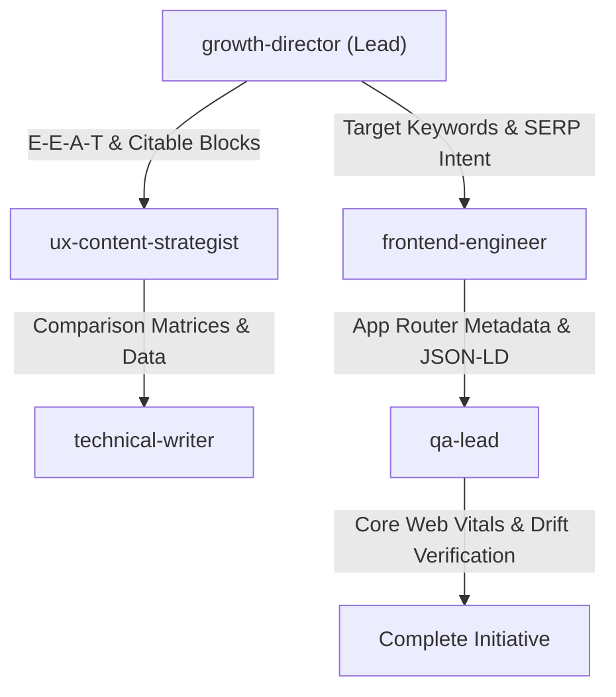

!`bash "${CLAUDE_SKILL_DIR}/../../hooks/yaml-helper.sh" resolve_config --keys locale,review_mode,automation`

Resolved above — use as-is; `--review` overrides `review_mode` for this run.

# Team SaaS SEO & Growth Engineering

> **Interaction Localization Rule**:
> When `locale: pt-BR` (or user speaks Portuguese), ALL questions (`AskUserQuestion` / `ask_question`), confirmation prompts, and selectable options MUST be translated and presented in **Brazilian Portuguese (PT-BR)**.
> Any English question text or options in this skill are illustrative examples — NEVER display English questions or options to a Portuguese developer.
> Internal reasoning, code synthesis, tests, and documentation files MUST remain in English.

Orchestrate the multidisciplinary SEO engineering team to implement high-ranking, AI-search-citable, and regression-tested search architecture for the SaaS product.

**Argument check:** If no initiative description is provided, prompt:
> "Usage: `/saas-team-seo [initiative description] [--review full|lean|solo]` — Describe the SEO or discovery feature (e.g., 'Next.js App Router dynamic metadata and sitemap', 'Competitor comparison pages for Stripe alternatives', 'AI search optimization and llms.txt endpoint')."

---

## Team Roles & Responsibilities

1. **`growth-director` (Tier 2 Lead)**:
   - Identifies business archetype, target buyer personas, ICP search queries, and competitor gap opportunities.
   - Designs hub-and-spoke topic architecture and determines whether programmatic expansion is viable.

2. **`frontend-engineer` (Tier 3 Execution)**:
   - Implements Next.js 14+ `generateMetadata` with full OpenGraph, Twitter Cards, and canonical tags.
   - Builds dynamic `app/robots.ts` and `app/sitemap.ts`.
   - Embeds server-rendered Schema.org JSON-LD React Server Components (`SoftwareApplication`, `Organization`, `Product`, `Offer`).
   - Implements machine-readable discovery (`app/llms.txt/route.ts` and `Accept: text/markdown` content negotiation).

3. **`ux-content-strategist` (Tier 2 Lead)**:
   - Drafts front-loaded citable answer blocks (130-170 words answering queries within the first 40-60 words).
   - Enforces E-E-A-T credentials, author bios, and factual sourcing.
   - Humanizes AI drafts, stripping AI cliches, padding, and invisible Unicode watermarks.

4. **`technical-writer` (Tier 3 Execution)**:
   - Builds accurate feature comparison matrices ("X vs Y", "Alternatives to X") with verifiable public citations.
   - Authors technical documentation, integration guides, and glossary entries for programmatic SEO directories.

5. **`qa-lead` (Tier 2 Lead)**:
   - Audits Core Web Vitals (LCP < 2.5s, CLS < 0.1, INP < 200ms) and mobile responsiveness.
   - Runs `scripts/seo/drift_baseline.py` to lock a pre-deploy snapshot.
   - Runs `scripts/seo/drift_compare.py` during CI/CD to ensure zero breaking regressions (no accidental `noindex`, dropped canonicals, or removed headings).

---

## 5-Step Collaborative Loop

1. **Question**: Present current SEO posture and baseline findings.
2. **Options**: Provide 2-3 architectural approaches (e.g. static SSG vs dynamic ISR metadata).
3. **Decision**: Agree on selected approach with user confirmation.
4. **Draft**: Formulate Next.js components, routes, and JSON-LD schemas.
5. **Approval**: Always ask `May I write this to [filepath]?` before modifying disk.
