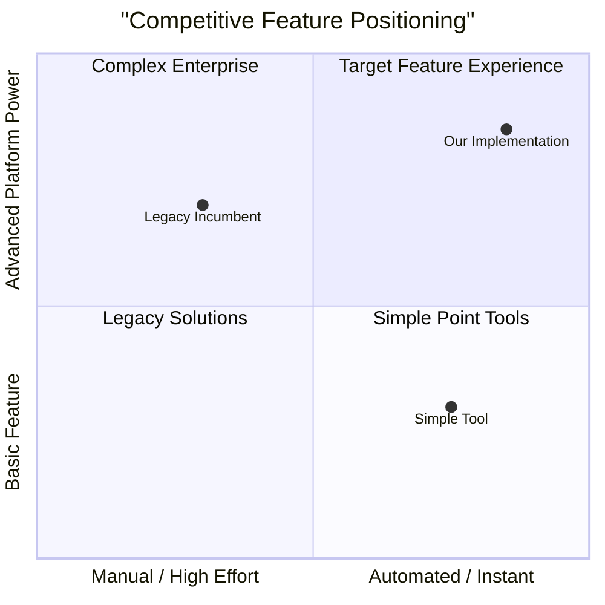

# [Module / Feature Name] — Product Requirement Document (PRD)

> **Status**: [Draft | In Review | Approved | Implemented]
> **Author**: [Product Manager / Lead Specialist]
> **Last Updated**: [YYYY-MM-DD]
> **Priority**: [P0 - MVP Blocker | P1 - Post-MVP | P2 - Future Enterprise]
> **Implements Pillar**: [Link to product pillar in docs/specs/product-pillars.md]

## Summary

[A concise 2-3 sentence executive summary of what this module does, why it exists, and who it serves.]

> **Quick Reference** — Layer: `[Foundation | Core | Integration | Presentation]` · Target Release: `[MVP / Beta / GA]` · Key Dependencies: `[Auth, Billing, Workspace, or "None"]`

---

## 1. Product Goals & Problem Statement

### 1.1 Top 3 Product Goals (Measurable)
1. **Activation Goal**: [e.g., Enable new users to configure their first project in < 2 minutes].
2. **Reliability Goal**: [e.g., Zero data loss with p99 API response time < 200ms].
3. **Monetization / Retention Goal**: [e.g., Drive > 10% free-to-paid conversion via self-serve upgrade].

### 1.2 Customer Pain Point & Use Cases
- **Customer Problem**: [Specific friction, delay, or risk currently experienced].
- **Primary Persona**: [e.g., Workspace Admin, Developer, Operations Manager].
- **Core Use Case**: [The primary day-to-day task accomplished using this feature].

---

## 2. Competitive Landscape & Positioning

### 2.1 Competitive Analysis Table

| Competitor | Feature Approach | Pros | Cons / Limitations | Our Strategic Advantage |
|---|---|---|---|---|
| **[Competitor 1]** | [Approach] | [Strength] | [Weakness] | [Why our solution wins] |
| **[Competitor 2]** | [Approach] | [Strength] | [Weakness] | [Why our solution wins] |

### 2.2 Competitive Positioning (2x2 Quadrant)



---

## 3. User Stories

### US-01: [Primary Happy Path]
- **As a** [user persona],
- **I want to** [perform an action],
- **So that** [achieve a specific business outcome].

### US-02: [Administrative / Governance]
- **As an** [admin / manager],
- **I want to** [configure settings / manage permissions],
- **So that** [govern organizational access safely].

---

## 4. Requirements Pool (P0 / P1 / P2)

### 4.1 Functional Requirements (P0 - MVP Launch Blockers)
- `REQ-001`: [Must-have capability with clear inputs, processing, and output]
- `REQ-002`: [Server-side action or API endpoint specification]
- `REQ-003`: [Immediate UI feedback, optimistic update, and error states]

### 4.2 Functional Requirements (P1 - Fast Follow)
- `REQ-101`: [Bulk operations / export capabilities]
- `REQ-102`: [Audit logging and notification triggers]

### 4.3 Non-Functional Requirements (P0 / P1)
- `NFR-001`: Response latency p95 < 200ms for core endpoints.
- `NFR-002`: Compliant with WCAG 2.2 AA accessibility standards (keyboard navigability, contrast).
- `NFR-003`: Responsive layout across Mobile (375px+), Tablet (768px+), and Desktop (1280px+).
- `NFR-004`: Complete multi-tenant isolation via Postgres Row-Level Security (RLS).

---

## 5. System Design & Data Contracts

### 5.1 Data Model (Prisma / SQL)
```prisma
model FeatureEntity {
  id          String   @id @default(cuid())
  workspaceId String
  name        String
  status      String   @default("active")
  metadata    Json?
  createdAt   DateTime @default(now())
  updatedAt   DateTime @updatedAt

  workspace   Workspace @relation(fields: [workspaceId], references: [id], onDelete: Cascade)

  @@index([workspaceId])
}
```

### 5.2 API Interfaces & Contract
| Method | Endpoint | Request Body | Response (200/201) | Auth Required |
|---|---|---|---|---|
| `POST` | `/api/v1/[feature]` | `{ name: string, metadata?: object }` | `{ id: string, name: string, status: string }` | Owner, Admin |
| `GET` | `/api/v1/[feature]` | Query: `?cursor=&limit=20` | `{ items: FeatureEntity[], nextCursor?: string }` | Member+ |
| `PATCH` | `/api/v1/[feature]/:id`| `{ name?: string, status?: string }` | `{ id: string, updated: boolean }` | Owner, Admin |
| `DELETE`| `/api/v1/[feature]/:id`| None | `{ success: boolean }` | Owner only |

---

## 6. Security, Permissions & Compliance

- **Role-Based Access Control (RBAC)**: Minimum role enforced at middleware and route handler.
- **Tenant Isolation**: All queries enforce `workspace_id = session.workspaceId` or Postgres RLS.
- **Audit Logging**: Destructive events (`DELETE`, `ROLE_CHANGE`) written to immutable `audit_logs` table.
- **Encryption**: TLS 1.3 in transit, AES-256 at rest.

---

## 7. Edge Cases & Resilience

| Scenario | Potential Failure | Handling Strategy |
|---|---|---|
| Network Disconnection | Unsaved form inputs | Local storage draft autosave + reconnect retry toast |
| Concurrency Conflict | Simultaneous edits by two admins | Optimistic locking with version check or last-write-wins warning |
| Rate Limit Exceeded | 429 Too Many Requests | Graceful UI backoff with `Retry-After` countdown |
| Invalid / Malformed Payload | Injection or validation error | HTTP 422 with structured Zod field-level error messages |

---

## 8. Acceptance Criteria (Given-When-Then)

### AC-01: [Feature Creation Workflow]
- **Given** an authenticated user with Admin permissions on the active workspace,
- **When** they submit valid data via the creation form,
- **Then** the record is persisted with their `workspace_id`,
- **And** an HTTP 201 response is returned with the new entity,
- **And** the UI updates optimistically with a success toast notification.

### AC-02: [Permission Rejection]
- **Given** an authenticated user with Viewer role,
- **When** they attempt to trigger a write or delete endpoint,
- **Then** the request is rejected with HTTP 403 Forbidden,
- **And** no database records are modified.
