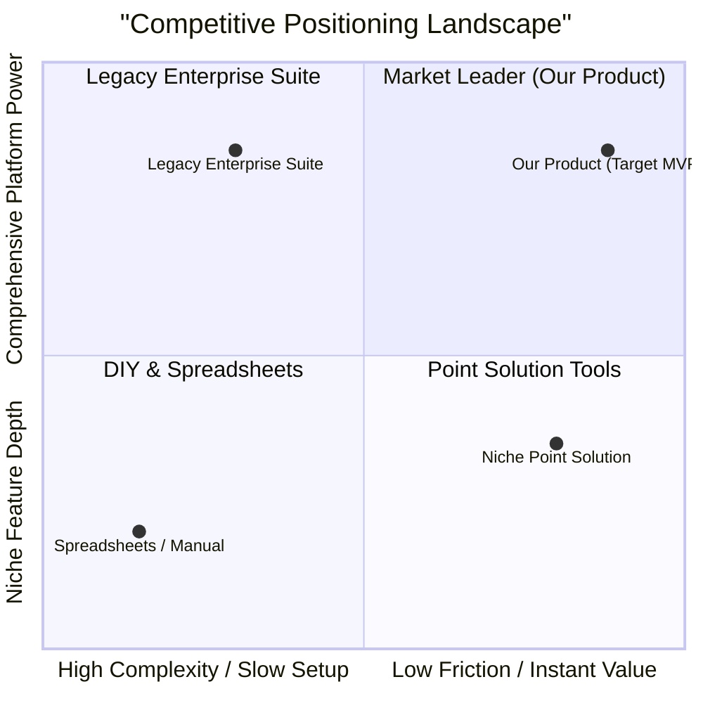
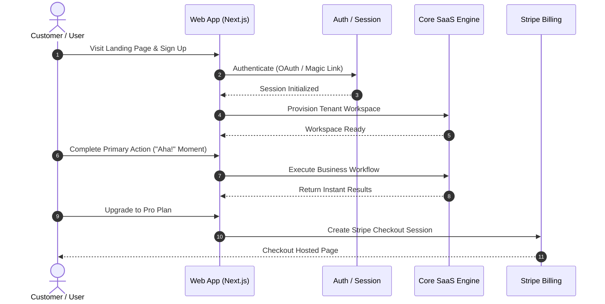

# Product Concept: [Product Name]

*Created: [YYYY-MM-DD]*
*Status: [Draft | Under Review | Approved]*
*Author: [Product Manager / Founder]*

---

## Elevator Pitch

> [1-2 sentences capturing the essence of the SaaS product. Format: "For [target audience] who [struggle with pain point], [Product Name] is a [category/solution] that [key benefit/outcome], unlike [alternative/status quo]."]

---

## 1. Product Identity & Market Opportunity

| Aspect | Detail |
|---|---|
| **Product Category** | [B2B SaaS / B2C SaaS / Developer Tool / Internal Tool / Marketplace] |
| **Target Market** | [SMB / Mid-Market / Enterprise / Indie Hackers / Creators] |
| **Ideal Customer Profile (ICP)** | [Role, company size, industry, tech stack, average budget] |
| **Delivery Model** | [Web App (SaaS), API-first, Chrome Extension, Mobile companion] |
| **Monetization Model** | [Subscription (Monthly/Annual), Per-Seat, Usage-Based / Metered, Freemium] |
| **Target Launch Horizon** | [MVP: 3-4 weeks / Beta: 8 weeks / GA: 12 weeks] |

---

## 2. Competitive Landscape & Positioning (Standard Engineering SOP)

### 2.1 Competitive Analysis Matrix

| Competitor | Core Strengths | Critical Weaknesses / Gaps | Pricing Model | Our Strategic Differentiator |
|---|---|---|---|---|
| **[Competitor A (Incumbent)]** | [Broad feature set, brand recognition] | [Clunky legacy UX, slow onboarding, expensive contracts] | [\$150+/seat/mo] | [Zero-setup, 10x faster workflow, modern UI] |
| **[Competitor B (Point Solution)]** | [Niche depth in single vertical] | [Lacks integrations, no API, rigid workflows] | [\$49/mo flat] | [Open API, extensible webhooks, full workflow coverage] |
| **[Alternative / DIY]** | [Free (Spreadsheets, Notion, internal scripts)] | [Manual data entry, unscalable, prone to human error] | [\$0 direct] | [Automated sync, persistent audit trail, zero maintenance] |

### 2.2 Competitive Positioning Quadrant (2x2 Matrix)

---

## 3. Problem Statement & Customer Pain

### 3.1 The Core Problem
[Detailed description of the customer problem. What friction, financial loss, or wasted hours do they experience today?]

### 3.2 Why Existing Alternatives Fail
- **Status Quo**: [Spreadsheets, manual emails, or custom internal scripts that break frequently]
- **Incumbent Software**: [Complex, bloated enterprise tools requiring weeks of training]
- **Customer Motivation to Switch**: [Too slow, poor UX, steep pricing, lack of modern AI/API integrations]

---

## 4. Value Proposition & The "Aha!" Moment

### 4.1 Value Proposition
[What is the primary superpower or efficiency gain this product delivers to the customer?]

### 4.2 The Unfair Advantage / Unique Differentiator
- **The Hook**: "It provides [core outcome], but unlike competitors, it [unique differentiator: 10x faster, zero-config, embedded AI, seamless modern integration]."
- **Time to First Value (Activation)**: New users should achieve their first meaningful result in under [e.g. 3 minutes].

---

## 5. Core User Workflows

---

## 6. Scope Tiers & Requirement Pool (P0 / P1 / P2)

### P0 - MVP (Launch Blocker)
- Self-serve authentication & tenant workspace onboarding.
- Core value workflow end-to-end with instant results.
- Self-serve Stripe billing (Pro monthly/annual subscription).
- Production deployment (SSL, custom domain, database pooling).

### P1 - Fast-Follow (Beta Phase)
- Team collaboration and role-based permissions (Owner, Admin, Member).
- Integrations (Slack webhooks, CSV export, Zapier API).
- Usage telemetry, audit logging, and automated digest emails.

### P2 - Enterprise & Growth (Scale Phase)
- Single Sign-On (SAML 2.0 / Okta).
- Custom domain branding for tenant workspaces.
- Dedicated database tenancy option and SOC 2 / HIPAA compliance pack.
