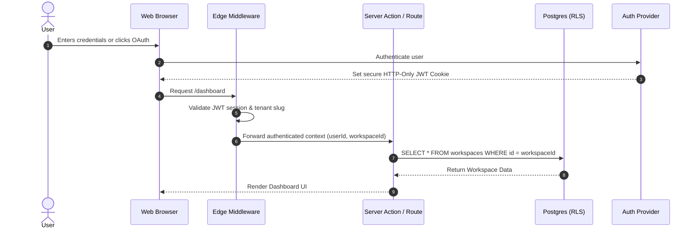
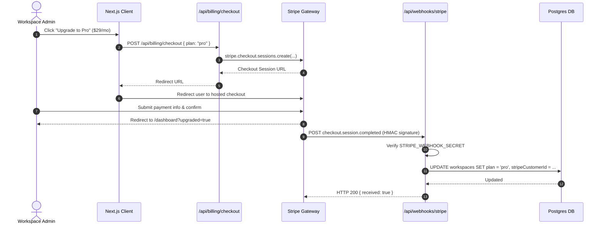

# System Architecture Blueprint: [Product Name]

## Document Status
- **Version**: 1.0
- **Last Updated**: [YYYY-MM-DD]
- **Author**: `lead-engineer` / `cloud-architect`
- **Reviewer**: `technical-director`
- **Related ADRs**: [ADR-0001, ADR-0002, ADR-0003]
- **Related PRDs**: [`docs/specs/features-modules-index.md`]

---

## 1. Technology Stack & Framework Inventory

| Architectural Tier | Selected Technology | Version Pinned | Rationale / ADR Link |
|---|---|---|---|
| **Frontend Framework** | Next.js (App Router) | [^15.0.0] | React Server Components, Streaming SSR, fast edge delivery |
| **Backend & API Layer** | Next.js Server Actions & Route Handlers / FastAPI | [Node 22 / Python 3.12] | Type-safe end-to-end RPC, minimal boilerplate |
| **Database & Pooling** | PostgreSQL with PgBouncer (Supabase / Neon) | [PostgreSQL 16] | Multi-tenant Row-Level Security (RLS), relational ACID integrity |
| **ORM / Query Builder** | Prisma ORM / Drizzle | [^6.0.0] | Strongly-typed migrations, schema-as-code |
| **Authentication** | Supabase Auth / Clerk / WorkOS | [v2] | JWT session management, RBAC, OAuth (Google/GitHub), Magic Link |
| **Billing & Payments** | Stripe Checkout & Webhooks | [2024-11-20] | Industry standard merchant infrastructure, SCA compliant |
| **Styling & UI Kit** | Tailwind CSS + shadcn/ui | [Tailwind v4 / v3.4] | Zero-runtime CSS, fully accessible Radix primitives |
| **Transactional Email**| Resend / Postmark | [Latest API] | High deliverability, React Email templates, SPF/DKIM/DMARC verified |
| **Observability** | Sentry + PostHog | [Latest SDK] | Real-time crash monitoring, session replay, product analytics |
| **Hosting & CI/CD** | Vercel / Cloudflare + GitHub Actions | [Production Edge] | Global Anycast CDN, automated preview builds |

---

## 2. High-Level C4 Architecture

### 2.1 C4 Container Diagram
```text
[Customer Browser / Mobile Client]
               │  (HTTPS / TLS 1.3)
               ▼
[Global Edge CDN (Vercel / Cloudflare)]
               │
       ┌───────┴───────────────────────┐
       ▼                               ▼
[Static UI / SSR Pages]       [API Route Handlers & Server Actions]
                                       │
                      ┌────────────────┼────────────────┐
                      ▼                ▼                ▼
            [Auth Provider]    [Postgres (RLS)]   [Stripe Webhooks]
              (Clerk/Supabase)   (Multi-Tenant)      (Idempotent)
```

---

## 3. Data Structures & Interfaces (Studio Architecture Standard)

### 3.1 Core TypeScript Interfaces & Schemas
```typescript
// Tenant & User Types
export interface UserSession {
  userId: string;
  email: string;
  role: 'owner' | 'admin' | 'member' | 'viewer';
  workspaceId: string;
}

export interface Workspace {
  id: string;
  name: string;
  slug: string;
  plan: 'free' | 'pro' | 'enterprise';
  stripeCustomerId?: string;
  stripeSubscriptionId?: string;
  createdAt: Date;
}

// API Response Wrapper
export interface ApiResponse<T> {
  success: boolean;
  data?: T;
  error?: {
    code: string;
    message: string;
    details?: Record<string, string[]>;
  };
}
```

### 3.2 Database Schema (Prisma Multi-Tenant RLS)
```prisma
datasource db {
  provider = "postgresql"
  url      = env("DATABASE_URL")
  directUrl= env("DIRECT_URL")
}

generator client {
  provider = "prisma-client-js"
}

model Workspace {
  id                   String        @id @default(cuid())
  name                 String
  slug                 String        @unique
  plan                 String        @default("free")
  stripeCustomerId     String?       @unique
  stripeSubscriptionId String?       @unique
  createdAt            DateTime      @default(now())
  updatedAt            DateTime      @updatedAt
  members              Membership[]
  features             FeatureItem[]

  @@map("workspaces")
}

model Membership {
  id          String    @id @default(cuid())
  workspaceId String
  userId      String
  role        String    @default("member") // owner, admin, member, viewer
  workspace   Workspace @relation(fields: [workspaceId], references: [id], onDelete: Cascade)

  @@unique([workspaceId, userId])
  @@map("memberships")
}

model FeatureItem {
  id          String    @id @default(cuid())
  workspaceId String
  name        String
  status      String    @default("active")
  workspace   Workspace @relation(fields: [workspaceId], references: [id], onDelete: Cascade)

  @@index([workspaceId])
  @@map("feature_items")
}
```

---

## 4. Program Call Flow & Sequence Diagrams (Studio Architecture Standard)

### 4.1 Primary End-to-End Workflow & Auth Flow


### 4.2 Billing Checkout & Webhook Reconciliation Flow


---

## 5. REST & OpenAPI Interface Specification

| HTTP Method | Route Endpoint | Description | Request Body | Response (200/201) | Permissions |
|---|---|---|---|---|---|
| `POST` | `/api/v1/auth/session` | Validate session token | None (Reads Cookie) | `{ user: UserSession }` | Public |
| `POST` | `/api/v1/workspaces` | Create new tenant workspace | `{ name: string, slug: string }` | `{ workspace: Workspace }` | Authenticated |
| `GET` | `/api/v1/features` | List tenant features (paginated)| Query: `?cursor=&limit=20` | `{ items: FeatureItem[] }` | Member+ |
| `POST` | `/api/v1/features` | Create new feature item | `{ name: string }` | `{ item: FeatureItem }` | Admin+ |
| `POST` | `/api/billing/checkout` | Create Stripe checkout session | `{ plan: "pro", interval: "month" }` | `{ url: string }` | Owner, Admin |
| `POST` | `/api/webhooks/stripe` | Process Stripe async webhooks | Raw Stripe Event payload | `{ received: boolean }` | Stripe (HMAC signed) |
| `GET` | `/api/health` | Service uptime and DB check | None | `{ status: "ok", timestamp: string }` | Public |

---

## 6. Non-Functional Budgets & Security Policies

| Performance Dimension | SLA / Budget Target | Verification Method |
|---|---|---|
| **API Response Latency (p95)** | < 200 ms | Server APM (CloudWatch / Datadog) |
| **Core Web Vitals (LCP)** | < 2.0 s on 4G mobile | Lighthouse / PageSpeed Insights in CI |
| **Initial JS Bundle Size** | < 180 KB gzipped | `@next/bundle-analyzer` |
| **Database Query Budget** | < 20 ms (all tenant queries indexed) | Postgres `pg_stat_statements` |
| **Uptime Commitment** | 99.9% availability | BetterStack / Pingdom health monitor |

---

## 7. Deployment Pipeline, Health Checks & Disaster Recovery

- **Health Endpoint**: `GET /api/health` returns HTTP 200 with DB ping status.
- **Database Migrations**: Applied during build step via `prisma migrate deploy` (zero-downtime expand-contract migrations).
- **Backups & RPO/RTO**: Automated daily PITR (Point-In-Time Recovery) backups on Postgres (RPO: 1 hour, RTO: 30 minutes).
- **Production Edge Rollout**: Vercel CLI `vercel --prod` or Docker orchestration with instant rollback on health check failure.
