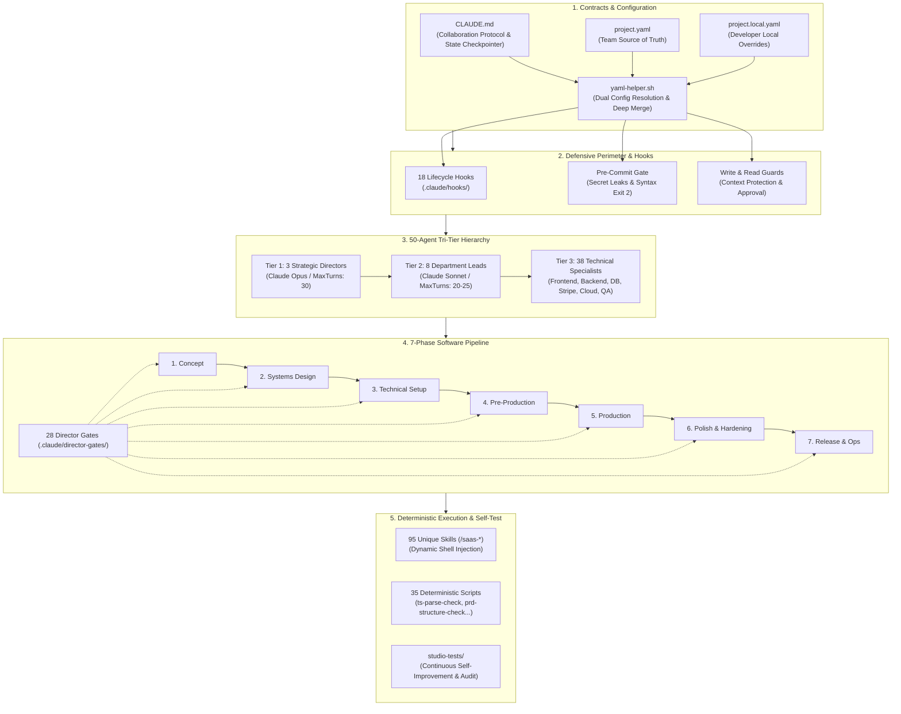
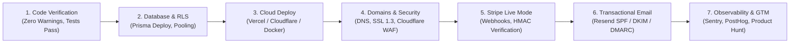

<p align="right">
  <a href="README.md">🇧🇷 Português (Brasil)</a> | <strong>🇺🇸 English</strong>
</p>

<p align="center">
  
</p>

# Basinfy SaaS Studio

<p align="center">
  <strong>Autonomous SaaS & Online Software Engineering Studio for Claude Code</strong><br>
  <em>Turn your Claude Code session into a coordinated 50-agent software development agency with 95 workflows and 28 governance gates.</em>
</p>

<p align="center">
  
  
  
  
  
  
  
</p>

---

## 🚀 Quick Install via NPX (Universal Multi-LLM)

Install and activate **Basinfy SaaS Studio** with a single command — with **zero dependencies** and instant startup (< 1s). Works natively across **Claude Code**, **Cursor**, **Antigravity / Gemini CLI**, **OpenAI Codex**, **VS Code & GitHub Copilot**, **Windsurf**, **Cline & Roo Code**, **Continue.dev**, **Aider**, **Devin**, and **Zed**.

### 1. Global Installation (Recommended)
Make all **50 agents** and **95 `/saas-*` commands** globally available in **any project or folder on your computer**:

```bash
# Install globally for ALL AI coding tools installed on your machine:
npx github:Basinfy/Basinfy-SaaS-Studio all --global

# Or install globally for your preferred tool:
npx github:Basinfy/Basinfy-SaaS-Studio claude --global
npx github:Basinfy/Basinfy-SaaS-Studio antigravity --global
npx github:Basinfy/Basinfy-SaaS-Studio cursor --global
npx github:Basinfy/Basinfy-SaaS-Studio codex --global
npx github:Basinfy/Basinfy-SaaS-Studio windsurf --global
```

### 2. Local Project Installation & Scaffolding
Create a fresh SaaS studio or inject into an existing codebase:

```bash
# Interactive guided setup (asks questions and configures your environment):
npx github:Basinfy/Basinfy-SaaS-Studio

# Scaffold a brand-new production SaaS project:
npx github:Basinfy/Basinfy-SaaS-Studio all --target ./my-saas-app

# Inject AI Studio into an existing Next.js / FastAPI project without overwriting app files:
npx github:Basinfy/Basinfy-SaaS-Studio all --mode inject

# Install configurations specifically for VS Code & Copilot, Cursor, or Codex:
npx github:Basinfy/Basinfy-SaaS-Studio vscode
npx github:Basinfy/Basinfy-SaaS-Studio cursor
npx github:Basinfy/Basinfy-SaaS-Studio codex
```

### Supported Platforms Matrix:

| Platform / Tool | Global Path | Workspace Configs | Slash Commands & Rules |
| :--- | :--- | :--- | :--- |
| **Claude Code** | `~/.claude/` | `.claude/`, `CLAUDE.md`, `project.yaml` | 95 skills (`/saas-*`), 50 agents, 28 gates |
| **Antigravity / Gemini** | `~/.gemini/config/skills/` | `GEMINI.md`, `.agents/skills/`, MCP | All 95 skills + autonomous 50-agent hierarchy |
| **Cursor** | `~/.cursor/rules/` | `.cursor/rules/saas-studio.mdc`, `.cursorrules`, `.cursor/mcp.json` | Full SaaS Studio agent context, rules & native MCP |
| **OpenAI Codex & ChatGPT** | `~/.codex/` | `CODEX.md`, `.codex/instructions.md`, `.codex/hooks.json` | Official OpenAI standard with hooks & engineering directives |
| **VS Code & GitHub Copilot** | - | `.vscode/`, `.github/copilot-instructions.md`, `.github/prompts/` | Workspace settings, tasks, extensions & slash prompts |
| **Windsurf** | `~/.codeium/windsurf/` | `.windsurf/rules/saas-studio.md`, `.windsurfrules` | Complete SaaS Studio SOP rules |
| **Cline & Roo-Code** | `~/.clinerules` | `.clinerules`, `.roomodes` | Autonomous instructions & custom modes (Directors, Leads, Devs) |
| **Continue.dev** | `~/.continue/` | `.continue/rules.md`, `.continue/config.json` | Standard prompt rules & custom commands (/saas-*) |
| **Aider** | `~/.aider.conf.yml` | `.aider.conf.yml`, `.aiderignore` | Auto-context configuration & test command |
| **Devin & Zed** | - | `.devin/`, `.zed/`, `AGENTS.md` | Universal open agentic standard conventions |

---

## 📑 Table of Contents

1. [Quick Install via NPX (Universal Multi-LLM)](#-quick-install-via-npx-universal-multi-llm)
2. [Executive Overview](#-executive-overview)
3. [Studio Architecture](#-studio-architecture)
4. [Deterministic Autonomous Software Engineering SOPs](#-deterministic-autonomous-software-engineering-sops)
5. [The 50-Agent Hierarchy](#-the-50-agent-hierarchy)
6. [The 7-Phase Software Pipeline](#-the-7-phase-software-pipeline)
7. [The 95 Slash Commands (`/saas-*`)](#-the-95-slash-commands-saas-)
8. [Director Gates & Quality Assurance](#-director-gates--quality-assurance)
9. [Enterprise Security & Defensive Perimeter](#-enterprise-security--defensive-perimeter)
10. [End-to-End Cloud Deployment & Publication](#-end-to-end-cloud-deployment--publication)
11. [Configuration & Dual-Resolution (`project.yaml`)](#-configuration--dual-resolution)
12. [Quickstart Guide & First Session Workflows](#-quickstart-guide)
13. [Smart Code Discovery & Dynamic Basinfy Protocol](#-smart-code-discovery--dynamic-basinfy-protocol)
14. [Automated Verification & Self-Improvement](#-automated-verification--self-improvement)

---

## ⚡ Executive Overview

**Basinfy SaaS Studio** is an enterprise-grade multi-agent orchestration architecture that transforms Claude Code into a complete, autonomous software development studio. Designed specifically for modern web applications, B2B/B2C SaaS platforms, APIs, and cloud microservices, it replaces unstructured AI coding with **deterministic software engineering processes**.

### Key Architectural Pillars:
- **Hierarchical Governance (3 Tiers)**: Strategic vision owned by Claude Opus Directors; departmental execution managed by Claude Sonnet Leads; hands-on implementation performed by 38 specialized technical agents.
- **Strict Collaboration Protocol**: Every critical mutation adheres to `Question -> Options -> Decision -> Draft -> Approval`. No silent file modifications.
- **28 Formal Director Gates**: Phase transitions require objective sign-offs with standardized verdicts (`READY / CONCERNS / NOT READY`, `SOUND / LEAKY BOUNDARIES`, etc.).
- **Collision-Proof Namespace (`/saas-*`)**: All 95 slash commands use the `/saas-` prefix, allowing coexistence with other Claude Code tools and extensions without namespace pollution.
- **Production-Ready Security Controls**: Pre-commit hooks enforce zero API secret exposure, mandatory PostgreSQL Row Level Security (RLS), and cryptographic verification of Stripe webhooks using raw bodies.
- **Durable Session Checkpointing**: `production/session-state/active.md` acts as an persistent state machine, surviving context compaction and session restarts.

---

## 💻 Supported Stacks & Technologies

**Basinfy SaaS Studio** is not limited to a single tech stack. It is a full **multi-language and multi-framework** platform with 38 execution specialists covering the industry's most widely adopted technologies:

| Category | Primary Supported Technologies | Dedicated Specialist Agents |
| :--- | :--- | :--- |
| 🐍 **Python Ecosystem** | **Python 3.11+**, **FastAPI**, **Django**, **Flask**, **SQLAlchemy**, **Alembic**, **Pydantic**, **Celery**, **Pytest** | `python-backend-specialist`, `fastapi-specialist`, `backend-engineer` |
| 🌐 **TypeScript & Node** | **Next.js 14+** (App Router / Server Actions), **React**, **Node.js**, **Express**, **Fastify**, **NestJS**, **Vue/Nuxt**, **SvelteKit** | `nextjs-specialist`, `react-specialist`, `frontend-engineer`, `backend-engineer` |
| 🦫 **Go (Golang)** | **Go 1.22+**, **Gin**, **Chi**, **Fiber**, high-concurrency microservices and Goroutines | `go-specialist`, `backend-engineer` |
| 🗄️ **Databases & ORMs** | **PostgreSQL**, **Supabase**, **Neon**, **MySQL**, **MongoDB**, **Redis**, **Prisma**, **Drizzle**, **SQLAlchemy** | `database-architect`, `supabase-specialist`, `prisma-drizzle-specialist` |
| 🔒 **Auth & Security** | **Supabase Auth**, **Clerk**, **NextAuth / Auth.js**, **WorkOS**, RBAC, Row Level Security (RLS) | `auth-security-specialist`, `appsec-engineer` |
| 💳 **Billing & Payments** | **Stripe**, **Paddle**, **LemonSqueezy**, Webhooks with raw cryptographic signature verification | `billing-engineer`, `pricing-economist` |
| ☁️ **Cloud, Infra & Queues** | **Docker**, **Kubernetes**, **AWS** (ECS, Lambda, S3, RDS), **Cloudflare** (Workers, D1, R2), **Vercel**, **Redis / Celery / BullMQ** | `docker-k8s-specialist`, `aws-specialist`, `cloudflare-specialist`, `queue-worker-specialist`, `devops-engineer` |
| 🤖 **Artificial Intelligence** | **OpenAI API**, **Anthropic Claude**, **LangChain**, **LlamaIndex**, embeddings and RAG | `ai-engineer` |

> **Configurable in your `project.yaml`:** Select your desired combination of frontend, backend, database, and cloud (e.g. *Python + FastAPI + PostgreSQL* or *Next.js + Supabase + Stripe* or *Go + Docker + AWS*). The studio dynamically routes tasks to the corresponding specialist agents!

---


## 🏛 Studio Architecture

The studio operates as an integrated system of 8 mechanical engines:



---

## 🧠 Deterministic Autonomous Software Engineering SOPs

Basinfy SaaS Studio incorporates and expands upon the core Standard Operating Procedures (SOPs) popularized by Autonomous Studio, transforming unstructured LLM interactions into rigorous, production-grade software engineering:

### 1. Requirements & PRD SOP (`WritePRD`)
- **Competitive Analysis Matrix**: Exhaustive benchmarking of direct competitors and status-quo alternatives across core capabilities, pricing models, and architectural trade-offs.
- **Competitive Positioning Quadrant**: Native Mermaid `quadrantChart` visualizing market position across friction vs capability dimensions.
- **P0/P1/P2 Requirement Pool**: Strict prioritization separating launch-blocking MVP requirements (P0) from fast-follow beta features (P1) and enterprise roadmap items (P2).
- **Formal User Stories**: Every requirement framed with Persona, Action, and Business Outcome, governed by Given-When-Then Acceptance Criteria.

### 2. Architecture & System Design SOP (`WriteDesign`)
- **Data Structures & Interfaces**: Strongly-typed TypeScript interfaces, Zod validation schemas, and Prisma multi-tenant data models.
- **REST & OpenAPI Contract Specification**: Explicit endpoint tables documenting HTTP methods, paths, request payloads, response envelopes, and authorization tiers.
- **Program Call Flow (Sequence Diagrams)**: End-to-end Mermaid `sequenceDiagram` models for critical journeys: Session Auth, Primary SaaS Actions, Stripe Checkout, and Asynchronous Webhook Reconciliation.

### 3. Task Decomposition & Topological Sorting SOP (`WriteTasks`)
- **Dependency DAG Sequencing**: Stories and implementation tasks are topologically sorted along the Directed Acyclic Graph:
  1. *Foundation & Data Layer*: Database migrations, Prisma models, Row-Level Security (RLS) policies, auth session middleware.
  2. *Core Services & Domain Logic*: Backend DAL, business engines, Stripe webhook handlers, asynchronous workers.
  3. *API & Server Actions*: HTTP Route Handlers, Zod schema validation, server actions, error mappers.
  4. *Client State & Hooks*: React Query / SWR hooks, Zustand state stores, optimistic UI mutators.
  5. *Presentation & UI Components*: shadcn/ui components, responsive layouts, forms, modals, empty states.
  6. *E2E Integration & Verification*: Playwright journey tests, audit trails, and regression verification.

### 4. Autonomous Self-Correction & Reflection Loop (`WriteCode` -> `RunCode`)
- **Self-Correction Protocol**: When automated tests, linter checks, or TypeScript compilers fail:
  1. *Traceback Extraction*: Captures stderr, file path, line number, and error code.
  2. *Root-Cause Reflection*: Diagnoses the root cause without touching unrelated modules.
  3. *Surgical Patch*: Applies targeted fix preserving all acceptance criteria.
  4. *Retest Loop*: Re-runs verification command (up to 3 reflection retries before flagging human review).


---


## 🔄 Built-in Auto-Updater (GitHub Sync)

Basinfy SaaS Studio includes a **continuous Auto-Update engine** that ensures your project and global environments always stay up-to-date with the latest skills, agents, and improvements published on GitHub, **while strictly preserving your application code and local settings**.

### 1. Update via CLI (NPX or Node)
Update your local project or global installations anytime:
```bash
# Update the current project (preserves your code in src/ and configs):
npx github:Basinfy/Basinfy-SaaS-Studio update

# Update global installations (~/.claude, ~/.gemini, ~/.cursor):
npx github:Basinfy/Basinfy-SaaS-Studio update --global
```

### 2. Update via Hook / Terminal
In your project directory:
```bash
bash .claude/hooks/update-check.sh apply
```

### 3. Automatic Updates on Session Start
In `project.yaml` or `project.local.yaml`, configure update behavior:
```yaml
updates:
  check: true     # true | false — checks for newer releases at session start
  auto: "prompt"  # "prompt" (notifies with update hint) | true (updates silently) | false
```
- **`"prompt"` mode (Default)**: Notifies you at session start with a one-command update hint when a newer release or commit exists on GitHub.
- **`true` mode (Fully Automatic)**: Silently downloads and updates framework files in the background upon session start.
- **Safety Guarantee**: The updater **NEVER** touches your code in `src/`, `app/`, `project.yaml`, `project.local.yaml`, or secrets in `.env*`.

---

## 🗑️ Framework Uninstallation (Safe Uninstall)

If you need to uninstall Basinfy SaaS Studio from your computer or from a specific project workspace, the `uninstall` command performs clean, surgical removal with full simulation (`--dry-run`) support:

### 1. Global Uninstallation (From all AI tools or a specific one)
```bash
# Uninstall globally from ALL supported AI tools (~/.claude, ~/.gemini, ~/.cursor, etc.):
npx github:Basinfy/Basinfy-SaaS-Studio uninstall --global

# Safe dry-run preview without deleting any files:
npx github:Basinfy/Basinfy-SaaS-Studio uninstall --global --dry-run

# Uninstall globally from a single specific platform:
npx github:Basinfy/Basinfy-SaaS-Studio uninstall antigravity --global
npx github:Basinfy/Basinfy-SaaS-Studio uninstall claude --global
npx github:Basinfy/Basinfy-SaaS-Studio uninstall cursor --global
```

### 2. Local Project Workspace Uninstallation
```bash
# Guided interactive wizard in the current project:
npx github:Basinfy/Basinfy-SaaS-Studio uninstall

# Direct uninstallation while preserving your project configuration (project.yaml):
npx github:Basinfy/Basinfy-SaaS-Studio uninstall --keep-config -f

# Complete cleanup including scaffolding directories (design/, docs/, production/):
npx github:Basinfy/Basinfy-SaaS-Studio uninstall --clean-all -f
```

> **Safety Guarantee**: The global uninstaller removes **only** the 50 studio agents, the 95 `saas-*` workflow skills, and official studio rules. Any custom skills in `~/.gemini/config/skills/` or business application code in `src/` remain completely untouched.

---

## 👥 The 50-Agent Hierarchy

### Tier 1 — Strategic Directors (Claude Opus / MaxTurns: 30)
| Agent | Role & Mandate | Tools & Constraints |
|---|---|---|
| [`product-director`](.claude/agents/product-director.md) | Ultimate authority on product vision, ICP, UVP, positioning, pricing strategy, and roadmap priorities. | Read, Glob, Grep, Write, Edit, WebSearch *(Disallowed: Bash)* |
| [`technical-director`](.claude/agents/technical-director.md) | Ultimate authority on software architecture, foundation ADRs, cloud scalability, tech stack, and cybersecurity. | Read, Glob, Grep, Write, Edit, Bash, WebSearch |
| [`delivery-producer`](.claude/agents/delivery-producer.md) | Milestone delivery governance (MVP, Beta, GA), sprint velocity, capacity planning, and scope creep management. | Read, Glob, Grep, Write, Edit, Bash, WebSearch *(Skills: scope-check, estimate)* |

### Tier 2 — Department Leads (Claude Sonnet / MaxTurns: 20-25)
| Agent | Department Domain | Core Responsibilities |
|---|---|---|
| [`lead-product-manager`](.claude/agents/lead-product-manager.md) | Product Management | PRDs, feature specifications, user stories, acceptance criteria, and competitive matrices. |
| [`lead-engineer`](.claude/agents/lead-engineer.md) | Engineering Architecture | Code standards enforcement, technical debt audits, code reviews, and design patterns. |
| [`design-system-director`](.claude/agents/design-system-director.md) | UI & Design Tokens | Design systems, Tailwind semantic tokens, shadcn/ui components, and brand identity. |
| [`growth-director`](.claude/agents/growth-director.md) | Growth & Activation | User acquisition, technical SEO, activation funnels, onboarding flows, and viral loops. |
| [`ux-content-strategist`](.claude/agents/ux-content-strategist.md) | UX Content & Copy | Microcopy, transactional emails, error messages, docs, and product voice/tone. |
| [`qa-lead`](.claude/agents/qa-lead.md) | Quality Assurance | Test pyramids (Unit, Integration, E2E), CI automation strategies, and quality gates. |
| [`release-manager`](.claude/agents/release-manager.md) | Release Engineering | Semantic versioning (SemVer), release checklists, changelog generation, and deployments. |
| [`localization-lead`](.claude/agents/localization-lead.md) | i18n & Localization | Translation tables, regional formatting, RTL layout compatibility, and string extraction. |

### Tier 3 — Technical & Domain Specialists (39 Agents)
* **Core Engineering & Cloud (12 Agents)**: `backend-engineer`, `cloud-infra-engineer`, `frontend-engineer`, `api-integrations-specialist`, `dev-tools-engineer`, `ai-engineer`, `web-perf-analyst`, `appsec-engineer`, `devops-engineer`, `billing-engineer` *(Stripe/Paddle)*, `database-architect`, `data-telemetry-engineer`.
* **SaaS Stack Specialists (15 Agents)**: `nextjs-specialist`, `react-specialist`, `tailwind-shadcn-specialist`, `supabase-specialist`, `prisma-drizzle-specialist`, `fastapi-specialist`, `python-backend-specialist`, `go-specialist`, `queue-worker-specialist`, `auth-security-specialist`, `cloudflare-specialist`, `aws-specialist`, `docker-k8s-specialist`, `realtime-websockets-specialist`, `email-messaging-specialist`.
* **Privacy, LGPD & Governance (1 Agent)**: `dpo-privacy-specialist` *(Data Protection Officer, LGPD/GDPR compliance, DPIA/RIPD & ROPA authoring)*.
* **Product, UX, QA & Ops (11 Agents)**: `user-flow-architect`, `ux-designer`, `ui-motion-designer`, `pricing-economist`, `technical-writer`, `onboarding-specialist`, `rapid-prototyper`, `qa-manual-tester`, `accessibility-auditor` *(WCAG 2.2 AA)*, `sre-observability-engineer`, `customer-success-ops`.

---

## 🔄 The 7-Phase Software Pipeline

Every SaaS project advances through a structured 7-stage lifecycle machine defined in [`.claude/docs/workflow-catalog.yaml`](.claude/docs/workflow-catalog.yaml):

| Phase | Core Objective | Primary Slash Commands | Gating Director Check |
|---|---|---|---|
| **1. Concept** | Value proposition, target personas (ICP), and business model validation. | `/saas-start`, `/saas-brainstorm`, `/saas-setup-stack`, `/saas-design-tokens` | `PD-PRODUCT-PILLARS` |
| **2. Systems Design** | PRDs, domain models, user flows, and dependency indexes. | `/saas-design-system`, `/saas-quick-design`, `/saas-review-all-prds` | `PD-PRD-ALIGNMENT` |
| **3. Technical Setup** | Architecture blueprint, foundation ADRs, DB schemas, test scaffolds. | `/saas-create-architecture`, `/saas-architecture-decision`, `/saas-test-setup` | `TD-PHASE-GATE` |
| **4. Pre-Production** | Technical spikes, end-to-end vertical slice, epic & story breakdown. | `/saas-prototype`, `/saas-vertical-slice`, `/saas-create-epics`, `/saas-sprint-plan` | `DP-MILESTONE-REVIEW` |
| **5. Production** | Test-driven implementation of user stories, code reviews, and bug triage. | `/saas-dev-story`, `/saas-code-review`, `/saas-story-done`, `/saas-qa-plan` | `QL-STORY-READY` |
| **6. Polish & Hardening** | Performance profiling, OWASP AppSec audit, and multi-tenant isolation. | `/saas-perf-profile`, `/saas-security-audit`, `/saas-load-test`, `/saas-design-review` | `TD-API-BOUNDARY` |
| **7. Release & Ops** | Staging/Prod deployment, changelogs, post-launch observability, customer support. | `/saas-release-checklist`, `/saas-launch-checklist`, `/saas-changelog`, `/saas-hotfix` | `DP-PHASE-GATE` |

> 🚀 **Fast-Track Minimal Mode**: For solo founders, hackathons, and rapid MVPs, configure `modes.rigor: minimal` in `project.yaml`. The studio automatically short-circuits formal gates to follow the streamlined path: **Stack Setup ➔ 1-Page Product Brief ➔ Direct Stories ➔ Continuous Build Cycle**.

---

## 🛠 The 95 Slash Commands (`/saas-*`)

All slash commands reside in [`.claude/skills/`](.claude/skills/) and feature dynamic configuration injection:

```text
Phase 1: Concept & Foundation (9)
  /saas-start                 Guided onboarding wizard for new or brownfield SaaS projects.
  /saas-help                  Workflow catalog navigator reporting current status and next actions.
  /saas-project-stage-detect  Diagnostic analyzer determining current pipeline maturity.
  /saas-setup-stack           Framework configuration (Next.js, FastAPI, Go, Supabase, Stripe).
  /saas-adopt                 Brownfield audit evaluating existing codebases for studio adoption.
  /saas-settings              Interactive viewer and updater for project.yaml and local overrides.
  /saas-brainstorm            Idea validation, ICP discovery, competitor analysis, and UVP drafting.
  /saas-design-tokens         Design tokens catalog (Tailwind, color palettes, spacing, typography).
  /saas-map-features          Functional feature decomposition and dependency graph mapping.

Phase 2: Systems Design & Specs (5)
  /saas-design-system         Author comprehensive PRDs with schemas, metrics, and user stories.
  /saas-quick-design          Lightweight specification for small tweaks, column additions, or rules.
  /saas-review-all-prds       Cross-PRD review auditing business logic inconsistencies.
  /saas-consistency-check     Automated scanning between PRDs, DB schemas, and API routes.
  /saas-propagate-design-change Impact analysis of PRD changes across ADRs, stories, and code.

Phase 3: Technical Setup & Architecture (10)
  /saas-create-architecture   Author the master architecture blueprint (C4 models, APIs, DB layer).
  /saas-architecture-decision Create formal Architecture Decision Records (ADRs) with trade-offs.
  /saas-architecture-review   Compliance audit verifying traceability between PRDs and ADRs.
  /saas-create-control-manifest Extract actionable Must-Do / Never-Do rules from accepted ADRs.
  /saas-ux-design             Comprehensive UX specification for layouts, modals, and screen states.
  /saas-ux-review             Usability review verifying compliance with semantic design tokens.
  /saas-test-setup            Scaffold testing harnesses (Vitest/Jest, Playwright, CI actions).
  /saas-test-helpers          Scaffold deterministic test fixtures, factories, and DB mocks.
  /saas-asset-spec            Visual component specifications and icon library requirements.
  /saas-gate-check            Phase transition engine evaluating criteria against Director Gates.

Phase 4: Pre-Production & Planning (10)
  /saas-prototype             Build isolated spikes to validate critical technical assumptions.
  /saas-vertical-slice        Implement end-to-end core flow (Signup -> Onboard -> Core -> Checkout).
  /saas-create-epics          Decompose architecture and PRDs into cohesive architectural epics.
  /saas-create-stories        Decompose epics into bite-sized user stories with Gherkin criteria.
  /saas-story-readiness       Pre-dev audit verifying PRD links, ADR guidance, and clear criteria.
  /saas-estimate              Parametric effort, risk, and complexity estimation per story.
  /saas-sprint-plan           Sprint backlog planning based on velocity and developer capacity.
  /saas-sprint-status         Real-time snapshot of active sprint, burndown, and open blockers.
  /saas-milestone-review      Executive review evaluating milestone readiness (MVP, Beta, GA).
  /saas-asset-audit           Audit UI components, bundle sizes, and static assets in public/.

Phase 5: Production & Development (11)
  /saas-dev-story             Implement a user story with test-driven validation.
  /saas-code-review           Architectural review of changes (SOLID, security, SQL efficiency).
  /saas-story-done            Validate acceptance criteria, verify tests, and log evidence.
  /saas-qa-plan               Author comprehensive sprint/epic QA plan across test layers.
  /saas-smoke-check           Execute critical-path smoke tests before staging hand-off.
  /saas-bug-report            Structured bug report generation with reproduction steps.
  /saas-bug-triage            Triage and prioritize reported issues (P0 Blocker to P3 Minor).
  /saas-retrospective         Sprint retrospective extracting operational insights.
  /saas-reverse-document      Reverse engineer PRDs and C4 diagrams from existing code.
  /saas-scope-check           Detect scope creep by comparing code against original PRDs.
  /saas-content-audit         Completeness audit comparing planned features against delivered routes.

Phase 6: Multi-Disciplinary Team Orchestration (9)
  /saas-team-growth           Growth team: Landing page, SEO, tracking, and onboarding tour.
  /saas-team-core-feature     Core engine team: Primary business value workflow implementation.
  /saas-team-auth-access      Security team: Authentication, RBAC, tenant isolation, and sessions.
  /saas-team-billing          Monetization team: Stripe billing, pricing tiers, and webhook engine.
  /saas-team-content          Content team: UX microcopy, API documentation, and help center.
  /saas-team-polish           Hardening team: Core Web Vitals, empty states, micro-interactions.
  /saas-team-qa               QA team: Automated test suites, Playwright E2E, and regression runs.
  /saas-team-release          Release team: Deployment pipeline, smoke checks, and rollback prep.
  /saas-team-ui               UI team: Design token alignment, accessible forms, and dark mode.

Phase 7: Hardening, Release & Operations (20)
  /saas-perf-profile          Profile Core Web Vitals (LCP, FID, CLS) and API p95 latencies.
  /saas-pricing-audit         Audit pricing tiers, unit economics, infrastructure margins, quotas.
  /saas-usability-test        Structured usability test logging with user feedback synthesis.
  /saas-security-audit        OWASP Top 10 security audit, dependency CVE scan, RLS verification.
  /saas-load-test             Stress test API endpoints, worker queues, and DB connection pools.
  /saas-regression-suite      Execute full regression test suite prior to production release.
  /saas-test-evidence-review  Audit test suites verifying that assertions are non-empty and strict.
  /saas-test-flakiness        Detect, quantify, and quarantine flaky tests from CI logs.
  /saas-release-checklist    Pre-release infrastructure verification (DNS, SSL, env vars).
  /saas-launch-checklist     Go-To-Market launch checklist (Product Hunt, docs, announcements).
  /saas-changelog             Automated technical changelog generation from conventional commits.
  /saas-patch-notes           Customer-facing release notes explaining new features and fixes.
  /saas-hotfix                Emergency hotfix workflow with minimal diff and targeted regression.
  /saas-post-launch-monitor   Post-launch monitoring (error rates, latencies, customer tickets).
  /saas-onboard               Generate self-guided onboarding documentation for new contributors.
  /saas-localize              Internationalization (i18n) pipeline: extract strings, verify RTL.
  /saas-design-review         Visual audit verifying UI implementation against design tokens.
  /saas-tech-debt             Maintain, prioritize, and track the technical debt register.
  /saas-skill-test            Automated testing framework verifying all studio skills and agents.
  /saas-skill-improve         Self-improvement loop (test-fix-retest) refining studio prompts.

Phase 8: Privacy, LGPD & Regulatory Compliance (21)
  /saas-lgpd                  Central compliance control plane: LGPD & GDPR program management.
  /saas-team-lgpd             Privacy squad orchestration (DPO, AppSec, Backend, DB, Legal).
  /saas-lgpd-audit            Full data protection readiness audit, risk mapping, and gap analysis.
  /saas-lgpd-legal-basis      Maps and formalizes lawful basis (Art. 7/11 LGPD) per data flow.
  /saas-lgpd-data-mapping     Lifecycle data mapping: ingestion, processing, sharing, and disposal.
  /saas-lgpd-ropa             Authors and maintains official ROPA (Record of Processing Activities).
  /saas-lgpd-ripd             Authors Data Protection Impact Assessment (RIPD / DPIA) for high risks.
  /saas-lgpd-consent-schema   Granular consent capture schema, audit trail, and 1-click revocation.
  /saas-lgpd-dsar             Automated Data Subject Access Request engine (access, erase, export).
  /saas-lgpd-privacy-policy   Drafts transparent, compliant Privacy Policies, Terms, and Cookie banners.
  /saas-lgpd-incident-response Security incident runbook with mandatory 72-hour ANPD/DPA notifications.
  /saas-lgpd-dpo-encarregado  Configures official DPO contact channels and governance protocols.
  /saas-lgpd-dpa              Generates Data Processing Agreements (DPAs) for vendors and operators.
  /saas-lgpd-international-transfer Cross-border transfer audits and standard contractual clauses (SCCs).
  /saas-lgpd-vendor-audit     Third-party sub-processor privacy audit and security classification.
  /saas-lgpd-audit-logging    Tamper-evident audit logs tracking all personal data access and mutation.
  /saas-lgpd-encryption-keys  Cryptographic key management (KMS, envelope encryption, rotation).
  /saas-lgpd-anonymization    Irreversible data anonymization and pseudonymization techniques.
  /saas-lgpd-retention-erasure Automated data retention policies and scheduled database purge jobs.
  /saas-lgpd-eca-digital-minors Enhanced safeguards and parental verification for minors (ECA Digital).
  /saas-lgpd-legacy-retrofit  Remediation roadmap to retrofit legacy databases and schemas into compliance.
```

---

## 🚦 Director Gates & Quality Assurance

Transitioning between major phases is guarded by **28 Director Gates** in [`.claude/director-gates/`](.claude/director-gates/). When `/saas-gate-check` runs, director agents evaluate objective criteria and emit binding standardized verdicts:

```text
Product Director (pd-*):
  pd-product-pillars.md     SOUND / CONCERNS / UNSOUND
  pd-prd-alignment.md       ALIGNED / DRIFT DETECTED
  pd-feature-coherence.md   COHERENT / CONFLICTS
  pd-messaging-tone.md      APPROVED / REVISE
  pd-usability-review.md    READY / CONCERNS / NOT READY
  pd-phase-gate.md          READY / CONCERNS / NOT READY

Technical Director (td-*):
  td-architecture-review.md SOUND / FLAWED
  td-adr-review.md          ACCEPTED / REJECTED
  td-stack-risk.md          LOW / MEDIUM / CRITICAL
  td-api-boundary.md        SOUND / LEAKY BOUNDARIES
  td-control-manifest.md    ENFORCED / VIOLATIONS
  td-feasibility.md         FEASIBLE / INFEASIBLE
  td-change-impact.md       APPROVED / BREAKING RISK
  td-phase-gate.md          READY / CONCERNS / NOT READY

Delivery Producer (dp-*):
  dp-epic-readiness.md      READY / NEEDS WORK
  dp-sprint-readiness.md    READY / BLOCKED
  dp-scope-assessment.md    ON TRACK / CREEP DETECTED
  dp-milestone-review.md    GO / NO-GO / PROCEED WITH RISK
  dp-phase-gate.md          READY / CONCERNS / NOT READY

Design System Director (ds-*):
  ds-design-tokens.md       READY / CONCERNS / NOT READY
  ds-branding-ui.md         APPROVED / REVISE
  ds-component-audit.md     PASS / CONCERNS / FAIL
  ds-phase-gate.md          READY / CONCERNS / NOT READY

Department Leads (ql-*, le-*, uxc-*):
  ql-story-ready.md         READY / BLOCKED
  ql-test-coverage.md       ADEQUATE / INSUFFICIENT
  le-code-review.md         APPROVE / REQUEST_CHANGES
  le-feasibility.md         FEASIBLE / RISKY / BLOCKED
  uxc-copy-consistency.md   CONSISTENT / INCONSISTENT
```

---

## 🔒 Enterprise Security & Defensive Perimeter

1. **Pre-Commit Defense ([`validate-commit.sh`](.claude/hooks/validate-commit.sh))**:
   - **Hard Block (Exit 2)** on API secret patterns (`sk_live_`, `ghp_`, `AKIA...`, private keys).
   - **Hard Block (Exit 2)** on staged `.env*` files.
   - Batch verification of staged JSON/YAML syntax using `git cat-file --batch`.
2. **Context & Mutation Guards ([`validate-read.sh`](.claude/hooks/validate-read.sh) & [`validate-write.sh`](.claude/hooks/validate-write.sh))**:
   - `read-guard.sh` prevents token blowup by intercepting reads of massive files (>250 lines), suggesting slicing or Grep.
   - `write-guard.sh` enforces the Collaboration Protocol, blocking overwrites of `package.json`, `tsconfig.json`, or `prisma/schema.prisma` without explicit user permission.
3. **Database Security Standards ([`.claude/rules/database-rules.md`](.claude/rules/database-rules.md))**:
   - Mandatory Row Level Security (RLS) on 100% of PostgreSQL tables.
   - All migrations must be fully reversible and typed.
4. **Billing Cryptographic Safety ([`.claude/rules/billing-rules.md`](.claude/rules/billing-rules.md))**:
   - Stripe webhooks must verify signatures against the **raw request body** (`request.text()`), never parsed JSON.
   - Client-side prices are strictly forbidden; all amounts are resolved server-side.

---

## 🚀 End-to-End Cloud Deployment & Publication

While traditional code generators stop at writing code, Basinfy SaaS Studio provides an exhaustive, battle-tested publication pipeline to take applications live:



1. **Automated Cloud Deployments**: First-class automation for Vercel CLI (`vercel --prod`), Cloudflare Workers (`wrangler deploy`), and containerized Docker environments.
2. **Database & Tenancy Hardening**: Automated zero-downtime migrations (`prisma migrate deploy`), connection pooling (PgBouncer), and verified PostgreSQL Row-Level Security (RLS).
3. **Stripe Live Production Activation**: Secure transition from test keys to live mode (`pk_live_`, `sk_live_`), verified customer portal configuration, and raw-body HMAC signature webhook verification.
4. **Email Deliverability Verification**: 100% verified SPF, DKIM, and DMARC DNS records with transactional email delivery tests (Resend / Postmark).
5. **Observability & Incident Readiness**: Sentry error tracking with release tagging, PostHog product analytics, `/api/health` automated uptime monitors, and 72-hour launch on-call rosters.
6. **Go-To-Market Launch Pack**: Product Hunt maker kits, social preview cards (OpenGraph), Terms of Service, and Privacy Policy compliance ready for day-one traffic.


---

## ⚙️ Configuration & Dual-Resolution

The studio relies on a dual-layer configuration pattern evaluated dynamically at runtime by [`.claude/hooks/yaml-helper.sh`](.claude/hooks/yaml-helper.sh):

```text
[project.local.yaml]  (Developer overrides, gitignored)
         ↓  deep merge
   [project.yaml]      (Team-wide single source of truth)
         ↓  expansion
   [modes.rigor]       (minimal | standard | full)
         ↓  fallback
   [defaults]
```

### Example `project.yaml`:
```yaml
schema_version: 1

project:
  name: "Acme SaaS"
  slug: "acme-saas"
  stage: "concept" # concept | systems-design | technical-setup | pre-production | production | polish | release

stack:
  frontend: "nextjs" # nextjs | react-vite | vue-nuxt
  backend: "nextjs-server-actions" # nextjs-server-actions | fastapi | go-gin
  database: "supabase-postgres" # supabase-postgres | neon-postgres
  orm: "prisma" # prisma | drizzle
  auth: "supabase-auth" # supabase-auth | clerk | authjs
  billing: "stripe" # stripe | paddle | lemonsqueezy
  deployment: "vercel" # vercel | cloudflare | aws

modes:
  rigor: "standard" # minimal (speed/hackathon) | standard (balanced) | full (enterprise)
  automation: "collaborative" # collaborative (ask first) | guided | autonomous
  review_mode: "lean" # solo | lean | full

performance:
  target_lcp_ms: 2000
  target_fid_ms: 100
  target_cls: 0.1
  max_initial_bundle_kb: 200
  api_p95_latency_ms: 250
```

---

## 🚀 Quickstart Guide & Practical Tutorials

**Basinfy SaaS Studio** operates seamlessly in two primary scenarios: building a brand-new SaaS product from scratch, or supercharging an existing repository with autonomous AI governance and 50 specialized agents.

---

### 🟢 Tutorial 1: Building a New SaaS Project from Scratch (Greenfield)

Follow this step-by-step workflow to build a production-ready SaaS with robust architecture, full documentation, test coverage, and a launch pipeline:

#### 1. Scaffold the Project with the CLI
Run the following command in your terminal to generate the full studio architecture:
```bash
# Create a new directory with the complete studio scaffolding
npx github:Basinfy/Basinfy-SaaS-Studio all --target ./my-new-saas

# Navigate into the project directory
cd my-new-saas
```

#### 2. Open in Your Preferred AI Tool
Launch a session in Claude Code, Cursor, Antigravity, or Windsurf:
```bash
# For Claude Code:
claude

# For Cursor / Windsurf:
cursor .
# or: windsurf .
```

#### 3. Run the Guided Onboarding Wizard
In your AI terminal or chat, trigger the master onboarding workflow:
```bash
/saas-start
```
The wizard analyzes your environment, guides you through stack selection, and populates `project.yaml`.

#### 4. Define Concept, ICP & Technology Stack
Structure and validate your SaaS positioning:
```bash
# 1. Brainstorm value proposition, ICP, and competitive differentiation:
/saas-brainstorm

# 2. Configure your official stack (Next.js, FastAPI, Supabase, Tailwind, Stripe):
/saas-setup-stack
```

#### 5. Design Architecture & Design System
Before writing production code, build deterministic specifications:
```bash
# 1. Define Tailwind semantic tokens (colors, typography, spacing):
/saas-design-tokens

# 2. Generate master architecture blueprints (C4 diagrams, service boundaries, schemas):
/saas-create-architecture

# 3. Author functional PRDs (Product Requirement Documents):
/saas-design-system
```

#### 6. Plan & Execute Development Sprints
Transform specifications into verified code with tests:
```bash
# 1. Decompose architecture into epics and user stories:
/saas-create-epics
/saas-create-stories

# 2. Plan your sprint backlog:
/saas-sprint-plan

# 3. Implement a user story using test-driven development (TDD):
/saas-dev-story SAAS-101

# 4. Verify acceptance criteria and log test evidence:
/saas-story-done SAAS-101
```

#### 7. Security Audit & Production Launch
Validate quality gates before deploying to production:
```bash
# 1. Run OWASP security scan, verify PostgreSQL RLS, and audit dependencies:
/saas-security-audit

# 2. Perform formal Director Gate evaluation for release readiness:
/saas-gate-check

# 3. Execute pre-flight checklist for cloud deployment:
/saas-release-checklist
```

---

### 🟡 Tutorial 2: Using in an Existing Repository (Brownfield)

If you have an existing application (e.g. Next.js, FastAPI, React, Node, or Python), you can safely inject the studio **without overwriting any of your existing code or configuration**:

#### 1. Navigate to Your Existing Project Directory
```bash
cd /path/to/my-existing-project
```

#### 2. Inject SaaS Studio Safely (`--mode inject`)
Run the CLI in brownfield injection mode:
```bash
npx github:Basinfy/Basinfy-SaaS-Studio all --mode inject
```
> **Zero Risk:** The `inject` mode adds only AI configuration folders (`.claude/`, `.cursor/`, `.agents/`, rules, and templates). It preserves 100% of your existing `package.json`, application source code (`src/` or `app/`), dependencies, and configuration files.

#### 3. Detect Your Project's Current Stage
Open your AI tool (`claude`, `cursor`, etc.) and run stage detection:
```bash
/saas-project-stage-detect
```
The studio scans your existing codebase and identifies which of the 7 phases your project is currently in (e.g. *Foundation*, *Feature Sprints*, or *Hardening*).

#### 4. Adoption Audit & Reverse Documentation
Integrate your existing codebase into the studio's governance:
```bash
# 1. Audit project compatibility with studio standards:
/saas-adopt

# 2. Reverse-engineer technical docs and PRDs from your existing code:
/saas-reverse-document
```

#### 5. Build New Features with 50 Specialized Agents
Leverage the agency hierarchy to accelerate feature development:
```bash
# Rapidly specify a new minor feature:
/saas-quick-design

# Implement the new story with TDD and acceptance criteria:
/saas-dev-story SAAS-NEW-FEATURE

# Perform architectural code review:
/saas-code-review
```

#### 6. Audit Security & Technical Debt
Elevate the quality and security of legacy code:
```bash
# Map, categorize, and prioritize technical debt:
/saas-tech-debt

# Scan for vulnerabilities, secret leaks, and database misconfigurations:
/saas-security-audit
```

---

### 📊 Quick Scenario Comparison

| Scenario | Install Command | First AI Command | Primary Goal |
| :--- | :--- | :--- | :--- |
| **New Project (From Scratch)** | `npx github:Basinfy/Basinfy-SaaS-Studio all --target ./app` | `/saas-start` | Build an entire SaaS from idea to cloud deploy with disciplined architecture |
| **Existing Project (Inject)** | `npx github:Basinfy/Basinfy-SaaS-Studio all --mode inject` | `/saas-project-stage-detect` | Add 50 agents & 95 workflows without touching existing application code |
| **Global Machine Install** | `npx github:Basinfy/Basinfy-SaaS-Studio all --global` | `/saas-help` | Enable all `/saas-*` workflows across every folder on your computer |

---

## 🔍 Smart Code Discovery & Dynamic Basinfy Protocol

**Basinfy SaaS Studio** features adaptive environment detection built into all agents and workflows:

### 1. Automatic & Transparent Detection
Before executing code searches, reading files, or inspecting symbols, the studio automatically checks:
- Whether a `.basinfy/` directory exists in the workspace root, or
- Whether Basinfy MCP tools (`basinfy_session_start`, `basinfy_search`, `basinfy_locate`, `basinfy_prepare_edit`, `basinfy_read`, `basinfy_impact`, etc.) or the `basinfy` CLI are active.

### 2. When Basinfy is Detected (`.basinfy/` present)
When Basinfy is detected, all 50 agents and 95 skills immediately route discovery through the **Basinfy Smart Indexing Protocol**:
- **Symbols & Functions**: Uses `basinfy_prepare_edit` or `basinfy_locate` to obtain definitions, gate checks, and dependency graphs in a single call.
- **Section Reading & Search**: Uses `basinfy_search` and `basinfy_read` for high-density retrieval without manual line offsets or regex scanning.
- **New File Scaffolding**: Runs `basinfy_prepare_create` before creating modules to enforce clean architectural boundaries.
- **Blast Radius Analysis**: Runs `basinfy_impact` or `basinfy_orbit` before applying multi-file refactors.
- **Context Efficiency**: Cuts token usage by up to 70% and prevents brute-force full-file reads.

### 3. Graceful Fallback Mode (No Basinfy installed)
If the workspace does not have Basinfy installed (no `.basinfy/` folder):
- The studio operates seamlessly and transparently using default IDE/LLM tools (`Grep`, `ripgrep`, `Glob`, `Read`).
- End-users can use the studio immediately on any repository without mandatory external dependencies.

---

## 🧪 Automated Verification & Self-Improvement

The studio includes an autonomous testing and audit engine in [`studio-tests/`](studio-tests/):

* **Integrity Audit**:
  ```bash
  python studio-tests/verify-integrity.py
  ```
  Runs 13 rigorous checks verifying agent counts, skill schemas, director gate verdicts, hook executions, and deterministic script outputs.
* **Skill Test Suite**:
  ```text
  /saas-skill-test
  ```
  Validates individual skills against behavioral quality rubrics.
* **Autonomous Self-Improvement**:
  ```text
  /saas-skill-improve
  ```
  Executes an autonomous test-fix-retest loop to continuously refine prompt quality, reducing token bloat and eliminating ambiguity.

---

<p align="center">
  <strong>Basinfy SaaS Studio</strong> — <em>Engineering discipline meets multi-agent autonomy.</em>
</p>
