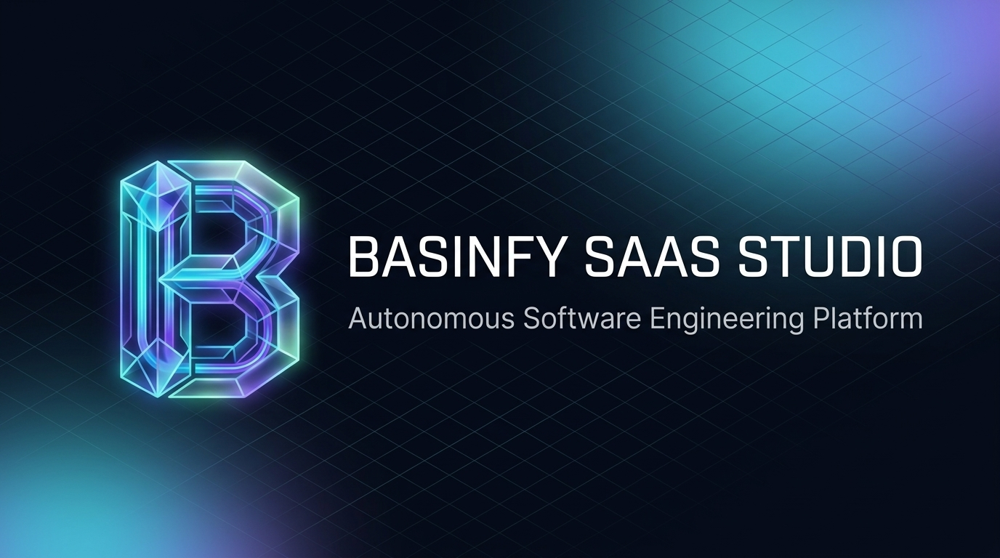

<p align="right">
  <strong>🇧🇷 Português (Brasil)</strong> | <a href="README.en.md">🇺🇸 English</a>
</p>

<p align="center">
  
</p>

# Basinfy SaaS Studio

<p align="center">
  <strong>Estúdio Autônomo de Engenharia de Software e SaaS para Claude Code, Cursor, Antigravity e Agentes de IA</strong><br>
  <em>Transforme sua sessão de IA em uma agência completa de desenvolvimento com 50 agentes especializados, 108 fluxos de trabalho e 28 gates de governança.</em>
</p>

<p align="center">
  
  
  
  
  
  
  
</p>

[Instalação](#-instalação-rápida-via-npx-universal-multi-llm) · [Primeiros passos](#verifique-a-instalação) · [Comandos](#-os-108-comandos-slash-saas-) · [Solução de problemas](#solução-de-problemas)

---

## 💡 O que é o Basinfy SaaS Studio na Prática?

Em termos práticos: **ele transforma sua ferramenta de IA (Claude Code, Cursor, Antigravity, Windsurf, Cline) em uma equipe completa e autônoma de desenvolvimento de software.**

Em vez de você ter que ficar digitando prompts soltos como *"crie uma tela de login"*, *"agora crie o backend"*, *"agora conecte o Stripe"* e torcer para o código não quebrar:

1. **Ele assume papéis reais de uma empresa de tecnologia**:
   Você não conversa com um modelo genérico. Você tem à sua disposição uma hierarquia com **50 profissionais especializados**:
   - Um **Diretor de Produto** (`product-director`) que valida se sua ideia de SaaS faz sentido comercial e define o modelo de monetização.
   - Um **Diretor Técnico** (`technical-director`) que desenha a arquitetura mestre, o banco de dados e as fronteiras da API.
   - Um **Líder de Engenharia** (`lead-engineer`) que audita a qualidade do código e refatora dívidas técnicas.
   - Um **Líder de QA** (`qa-lead`) que garante testes unitários, testes de integração e testes E2E.
   - **Especialistas dedicados** em Next.js, FastAPI, Supabase, Tailwind, Stripe, Docker, AWS e Segurança.

2. **Ele segue um processo de engenharia ponta a ponta**:
   O estúdio conduz seu projeto por 7 fases com 108 comandos práticos (`/saas-*`):
   - **Quer tirar uma ideia do papel?** Digite `/saas-start` e o estúdio entrevista você, sugere stacks e cria a fundação do projeto.
   - **Quer especificar funcionalidades?** Digite `/saas-design-system` e ele gera especificações técnicas (PRDs) completas.
   - **Quer codificar uma funcionalidade?** Digite `/saas-dev-story [ID]` e o especialista constrói o código com testes automatizados e segurança.
   - **Quer revisar o código?** Digite `/saas-code-review` e `/saas-security-audit` para encontrar bugs, falhas de segurança e injeções antes de ir pro ar.
   - **Quer lançar?** Digite `/saas-release-checklist` e ele audita variáveis de ambiente, DNS, banco de dados e gateways de pagamento.

3. **Você escolhe o nível de automação**:
   No modo colaborativo padrão, o estúdio solicita aprovação antes de aplicar as mudanças de uma etapa. Os modos guiado e autônomo seguem as regras de confirmação configuradas no projeto.

4. **Funciona tanto para projetos novos quanto para repositórios existentes**:
   - **Começando do zero?** A instalação prepara a estrutura do estúdio. Os fluxos seguintes ajudam a definir a arquitetura, o design e a implementação.
   - **Já tem um projeto em andamento?** Injeta os agentes e workflows no repositório sem alterar nenhuma linha do seu código atual, analisa em que estágio seu projeto está e te ajuda a evoluir a partir dali.

5. **Modo Fundador / Usuário Leigo (`user_profile: founder`) — Do Zero ao SaaS sem Saber Programar**:
   - **Não sabe o que é banco de dados, ORM, API ou arquitetura?** Sem problema: você não precisa decorar nenhum dos 108 comandos nem entender jargões técnicos.
   - Basta descrever sua ideia em português simples (*"Quero criar um sistema de agendamento para clínicas cobrando assinatura mensal"*): o **Maestro Contínuo** faz apenas perguntas de negócio com a opção **`(Recomendado)`** destacada, aplica automaticamente a *Golden Stack* segura (Next.js + Tailwind/shadcn + Supabase + Prisma + Stripe + Vercel) e protege seu SaaS nos bastidores com segurança multi-empresa (RLS), LGPD e SEO.

---

## 🚀 Instalação Rápida via NPX (Universal Multi-LLM)

### Pré-requisitos

- **Instalação** — Node.js 18 ou superior com npm/NPX, Git e acesso ao GitHub. A CI usa Node.js 22. Confira com `node --version`, `npx --version` e `git --version`.
- **Uso** — Abra a pasta do projeto em um cliente de IA compatível. Os auxiliares de shell e configuração usam Bash e Python 3. No Windows, use Git Bash para os auxiliares Bash ou execute o cliente e os auxiliares dentro do WSL.
- **Testes do estúdio** — Use um clone do repositório, Bash e Python com PyYAML. Veja [como rodar as verificações](#contribuição-e-testes).

### 1. Instalação global

Instale as skills e configurações de usuário nos clientes que oferecem descoberta global:

```bash
# Instalação global para TODAS as ferramentas de IA da sua máquina:
npx github:Basinfy/Basinfy-SaaS-Studio all --global

# Ou instale globalmente apenas para a sua ferramenta favorita:
npx github:Basinfy/Basinfy-SaaS-Studio claude --global
npx github:Basinfy/Basinfy-SaaS-Studio antigravity --global
npx github:Basinfy/Basinfy-SaaS-Studio cursor --global
npx github:Basinfy/Basinfy-SaaS-Studio codex --global
npx github:Basinfy/Basinfy-SaaS-Studio windsurf --global
```

> A instalação global disponibiliza skills nos clientes que aceitam diretórios de usuário. Rode a instalação local em cada projeto para adicionar a configuração, os scripts e o catálogo que os fluxos usam.

### 2. Instalação Local no Projeto & Scaffolding
Use `scaffold` (padrão) em uma pasta nova para criar a estrutura de documentação, design e entrega. O código da aplicação é desenvolvido nos fluxos seguintes. Use `inject` na raiz de um projeto existente para adicionar o estúdio e as integrações do cliente:

```bash
# Assistente guiado interativo (faz perguntas e configura o ambiente):
npx github:Basinfy/Basinfy-SaaS-Studio

# Preparar a estrutura do estúdio em uma pasta nova:
npx github:Basinfy/Basinfy-SaaS-Studio all --target ./meu-saas-app

# Injetar o Estúdio de IA em um projeto existente (Next.js, FastAPI, Node) sem sobrescrever código:
npx github:Basinfy/Basinfy-SaaS-Studio all --mode inject

# Instalar configurações específicas para VS Code & Copilot, Cursor ou Codex:
npx github:Basinfy/Basinfy-SaaS-Studio vscode
npx github:Basinfy/Basinfy-SaaS-Studio cursor
npx github:Basinfy/Basinfy-SaaS-Studio codex
```

### Verifique a instalação

1. Abra a pasta de destino no seu cliente de IA e inicie uma nova sessão.
2. Confira se existem `project.yaml` e `.claude/skills/saas-help/SKILL.md`. Instalações portáteis também incluem `.agents/skills/`.
3. No chat, execute `/saas-help`. A resposta deve indicar a fase do projeto e sugerir o próximo passo. Se o cliente não exibir comandos slash, peça para usar a skill `saas-help` ou para ler o `SKILL.md` correspondente.
4. Para um projeto novo, execute `/saas-start` ou descreva a ideia em linguagem natural. Para um projeto existente, execute `/saas-project-stage-detect` com a pasta do código aberta.

Em um repositório existente, use `npx github:Basinfy/Basinfy-SaaS-Studio all --mode inject --dry-run` para conferir o destino e o modo antes de instalar. Depois da instalação, revise `git status --short` para ver os arquivos adicionados.

### 3. Instalação no WSL (Windows Subsystem for Linux)

Windows e WSL têm diretórios de usuário separados. O instalador usa `os.homedir()` do Node.js em execução: com Node.js do Linux, instala no usuário da distribuição WSL; com Node.js do Windows, instala no perfil do Windows. Os nomes das pastas são os mesmos, mas uma instalação global no Windows não instala automaticamente no WSL.

| Ambiente | Exemplo de diretório do usuário | Exemplo de skills globais |
| :--- | :--- | :--- |
| Windows | `C:\Users\Ana` | `C:\Users\Ana\.agents\skills` |
| WSL (Linux) | `/home/ana` | `/home/ana/.agents/skills` |

**Execute no terminal da distribuição WSL**, com Node.js 18+ e npm instalados no Linux. Confira o ambiente antes de instalar:

```bash
command -v node npm npx
node -p 'process.platform + " | " + require("node:os").homedir()'
# Esperado: linux | /home/seu-usuario (ou o home configurado no Linux)

# Instalar globalmente para os clientes executados dentro do WSL:
npx github:Basinfy/Basinfy-SaaS-Studio all --global

# Ou somente para o Codex executado no WSL:
npx github:Basinfy/Basinfy-SaaS-Studio codex --global
```

Se aparecer `win32`, o Node.js em execução é do Windows: configure Node.js e npm no Linux antes de instalar. Confira também se `npm` e `npx` pertencem à instalação Linux. Não use `sudo` para executar o instalador, pois a instalação global deve pertencer ao usuário que executa o cliente de IA.

O mesmo comando universal atende ao WSL; não é necessária uma opção `--wsl`. Instale globalmente no ambiente em que o cliente de IA executa. Para usar clientes tanto no Windows quanto no WSL, execute a instalação em cada ambiente.

Para adicionar os recursos locais a um projeto existente, execute no diretório do projeto dentro do WSL:

```bash
cd ~/meu-saas-app
npx github:Basinfy/Basinfy-SaaS-Studio all --mode inject

# Atualizar ou remover a instalação global do usuário do WSL:
npx github:Basinfy/Basinfy-SaaS-Studio update --global
npx github:Basinfy/Basinfy-SaaS-Studio uninstall --global
```

Os arquivos locais, como `.agents/skills/` e `.claude/`, ficam relativos ao projeto. Um projeto do Windows pode ser acessado pelo WSL, normalmente em `/mnt/c/Users/...`; isso não transforma o perfil global do Windows no home do Linux. Para projetos trabalhados com ferramentas Linux, a Microsoft recomenda armazená-los no sistema de arquivos Linux, por exemplo `~/meu-saas-app` ([documentação do WSL](https://learn.microsoft.com/en-us/windows/wsl/filesystems)).

### Matriz de Plataformas Suportadas:

| Plataforma / Ferramenta | Caminho Global | Configurações Locais | Comandos Slash & Regras |
| :--- | :--- | :--- | :--- |
| **Claude Code** | `~/.claude/` | `.claude/`, `CLAUDE.md`, `project.yaml` | 108 skills (`/saas-*`), 50 agentes, 28 gates |
| **Antigravity / Gemini** | `~/.gemini/config/skills/` | `GEMINI.md`, `.agents/skills/`, MCP | Todas as 108 skills + hierarquia de 50 agentes |
| **Cursor** | `~/.cursor/rules/` | `.cursor/rules/saas-studio.mdc`, `.cursorrules`, `.cursor/mcp.json` | Contexto completo do estúdio, regras e MCP nativo |
| **OpenAI Codex & ChatGPT** | `~/.codex/` | `CODEX.md`, `.codex/instructions.md`, `.codex/hooks.json` | Padrão oficial OpenAI com hooks e diretrizes de engenharia |
| **VS Code & GitHub Copilot** | - | `.vscode/`, `.github/copilot-instructions.md`, `.github/prompts/` | Configurações de workspace, tarefas, extensões e slash prompts |
| **Windsurf** | `~/.codeium/windsurf/` | `.windsurf/rules/saas-studio.md`, `.windsurfrules` | Regras completas de engenharia e SOPs |
| **Cline & Roo-Code** | `~/.clinerules` | `.clinerules`, `.roomodes` | Instruções operacionais e modos customizados (Diretores, Leads, Devs) |
| **Continue.dev** | `~/.continue/` | `.continue/rules.md`, `.continue/config.json` | Contexto padronizado e custom commands (/saas-*) |
| **Aider** | `~/.aider.conf.yml` | `.aider.conf.yml`, `.aiderignore` | Configuração com auto-contexto e comando de teste |
| **Devin & Zed** | - | `.devin/`, `.zed/`, `AGENTS.md` | Padrão aberto universal de agentes |

---

## 📑 Sumário

1. [O que é o Basinfy SaaS Studio na Prática?](#-o-que-é-o-basinfy-saas-studio-na-prática)
2. [Instalação Rápida via NPX (Universal Multi-LLM)](#-instalação-rápida-via-npx-universal-multi-llm) · [Atualização](#-auto-updater-do-estúdio-sincronização-com-github) · [Desinstalação](#-desinstalação-do-estúdio-uninstall-seguro)
3. [Visão Executiva](#-visão-executiva)
4. [Stacks & Tecnologias Suportadas](#-stacks--tecnologias-suportadas)
5. [Arquitetura do Estúdio](#-arquitetura-do-estúdio)
6. [SOPs Determinísticos de Engenharia de Software](#-sops-determinísticos-de-engenharia-de-software)
7. [A Hierarquia dos 50 Agentes](#-a-hierarquia-dos-50-agentes)
8. [O Pipeline de Software em 7 Fases](#-o-pipeline-de-software-em-7-fases)
9. [Os 108 Comandos Slash (`/saas-*`)](#-os-108-comandos-slash-saas-) · [Comandos de terminal](#comandos-de-terminal)
10. [Director Gates & Controle de Qualidade](#-director-gates--controle-de-qualidade)
11. [Segurança Empresarial & Perímetro Defensivo](#-segurança-empresarial--perímetro-defensivo)
12. [Deploy em Nuvem & Publicação de Ponta a Ponta](#-deploy-em-nuvem--publicação-de-ponta-a-ponta)
13. [Configuração & Resolução Dupla (`project.yaml`)](#-configuração--resolução-dupla-projectyaml) · [Mapa de arquivos](#mapa-de-arquivos)
14. [Guia de Início Rápido & Tutoriais Práticos](#-guia-de-início-rápido--tutoriais-práticos)
15. [Descoberta Inteligente de Código & Protocolo Dinâmico Basinfy](#-descoberta-inteligente-de-código--protocolo-dinâmico-basinfy)
16. [Verificação Automatizada & Autocura](#-verificação-automatizada--autocura)
17. [Solução de problemas](#solução-de-problemas) · [Contribuição e testes](#contribuição-e-testes)

---

## ⚡ Visão Executiva

O **Basinfy SaaS Studio** é uma arquitetura corporativa de orquestração multi-agente que transforma ferramentas de IA em uma agência completa e autônoma de desenvolvimento de software. Desenvolvido especificamente para aplicações web modernas, plataformas SaaS B2B/B2C, APIs robustas e microsserviços em nuvem, ele substitui a codificação desestruturada por **processos determinísticos de engenharia de software**.

### Pilares Arquiteturais Fundamentais:
- **Governança Hierárquica em 3 Tiers**: Visão estratégica gerenciada por Diretores Claude Opus; liderança técnica e de produto conduzida por Líderes Claude Sonnet; e execução técnica por 38 agentes especialistas.
- **Protocolo Estrito de Colaboração**: Toda mutação crítica obedece ao fluxo `Pergunta -> Opções -> Decisão -> Rascunho -> Aprovação`. Nenhuma alteração silenciosa ou destrutiva sem confirmação expressa do desenvolvedor.
- **28 Director Gates Formais**: Transições de fase exigem aprovações formais com vereditos técnicos padronizados (`READY / CONCERNS / NOT READY`, `SOUND / LEAKY BOUNDARIES`, etc.).
- **Namespace Sem Conflitos (`/saas-*`)**: Todos os 96 comandos utilizam o prefixo `/saas-`, permitindo coexistência perfeita com outras extensões e comandos do seu ambiente.
- **Controles de Segurança de Nível Corporativo**: Hooks de pre-commit bloqueiam vazamentos de credenciais e segredos de API, exigem PostgreSQL Row Level Security (RLS) e validam assinaturas criptográficas de webhooks do Stripe com payload bruto.
- **Checkpointing Durável de Sessão**: O arquivo `production/session-state/active.md` opera como uma máquina de estado persistente, imune a compactações de contexto, quedas ou reinicializações.
- **Indexação Semântica Inteligente com Basinfy**: Roteamento prioritário de busca de código pelo grafo de importações e bacias de dependência antes de recorrer a buscas cegas por grep/rg.

---

## 💻 Stacks & Tecnologias Suportadas

O **Basinfy SaaS Studio** não é limitado a uma única tecnologia. Ele é uma plataforma **multi-linguagem e multi-stack** com 38 especialistas de execução cobrindo os ecossistemas mais utilizados no mercado:

| Categoria | Tecnologias Principais Suportadas | Agentes Especialistas Dedicados |
| :--- | :--- | :--- |
| 🐍 **Python Ecosystem** | **Python 3.11+**, **FastAPI**, **Django**, **Flask**, **SQLAlchemy**, **Alembic**, **Pydantic**, **Celery**, **Pytest** | `python-backend-specialist`, `fastapi-specialist`, `backend-engineer` |
| 🌐 **TypeScript & Node** | **Next.js 14+** (App Router / Server Actions), **React**, **Node.js**, **Express**, **Fastify**, **NestJS**, **Vue/Nuxt**, **SvelteKit** | `nextjs-specialist`, `react-specialist`, `frontend-engineer`, `backend-engineer` |
| 🦫 **Go (Golang)** | **Go 1.22+**, **Gin**, **Chi**, **Fiber**, microsserviços de alta concorrência e Goroutines | `go-specialist`, `backend-engineer` |
| 🗄️ **Bancos de Dados & ORMs** | **PostgreSQL**, **Supabase**, **Neon**, **MySQL**, **MongoDB**, **Redis**, **Prisma**, **Drizzle**, **SQLAlchemy** | `database-architect`, `supabase-specialist`, `prisma-drizzle-specialist` |
| 🔒 **Auth & Segurança** | **Supabase Auth**, **Clerk**, **NextAuth / Auth.js**, **WorkOS**, RBAC, Row Level Security (RLS) | `auth-security-specialist`, `appsec-engineer` |
| 💳 **Billing & Pagamentos** | **Stripe**, **Paddle**, **LemonSqueezy**, Webhooks com verificação criptográfica de payload bruto | `billing-engineer`, `pricing-economist` |
| ☁️ **Nuvem, Infra & Filas** | **Docker**, **Kubernetes**, **AWS** (ECS, Lambda, S3, RDS), **Cloudflare** (Workers, D1, R2), **Vercel**, **Redis / Celery / BullMQ** | `docker-k8s-specialist`, `aws-specialist`, `cloudflare-specialist`, `queue-worker-specialist`, `devops-engineer` |
| 🤖 **Inteligência Artificial** | **OpenAI API**, **Anthropic Claude**, **LangChain**, **LlamaIndex**, embeddings e RAG | `ai-engineer` |

> **Configurável no seu `project.yaml`:** Você escolhe a sua combinação favorita de frontend, backend, banco e nuvem (ex: *Python + FastAPI + PostgreSQL* ou *Next.js + Supabase + Stripe* ou *Go + Docker + AWS*). O estúdio aciona automaticamente os agentes especialistas correspondentes à sua escolha!

---


## 🏛 Arquitetura do Estúdio

O estúdio opera como um sistema integrado com 8 motores mecânicos complementares:

```mermaid
flowchart TD
    subgraph ConfigLayer["1. Contratos & Configuração"]
        CM["CLAUDE.md / GEMINI.md<br/>(Protocolo de Colaboração & Checkpoints)"]
        PY["project.yaml<br/>(Fonte Única de Verdade da Equipe)"]
        PLY["project.local.yaml<br/>(Sobrescritas Locais do Desenvolvedor)"]
        YH["yaml-helper.sh<br/>(Resolução Dupla & Deep Merge)"]
    end

    subgraph AgentLayer["2. Hierarquia de Agentes (50 Especialistas)"]
        T1["Tier 1: Diretores Estratégicos<br/>(Opus / MaxTurns: 30)"]
        T2["Tier 2: Líderes de Departamento<br/>(Sonnet / MaxTurns: 25)"]
        T3["Tier 3: Especialistas de Execução<br/>(Sonnet / MaxTurns: 20)"]
    end

    subgraph SkillLayer["3. Motor de Habilidades (108 Comandos /saas-*)"]
        SK["Skills Canônicas & Avaliações Shell (!)<br/>Subpastas references/ dedicadas"]
    end

    subgraph GateLayer["4. Governança Formal (28 Director Gates)"]
        DG["Critérios Estritos de Aceite & Vereditos Objetivos<br/>Checklist de Transição de Fases"]
    end

    subgraph HookLayer["5. Perímetro Defensivo (18 Hooks Bash)"]
        HK["Pre-Commit (Anti-Vazamento de Segredos, Validação YAML/JSON)<br/>Write-Guard, Post-Checkout & Statusline"]
    end

    subgraph RuleLayer["6. Regras de Código (14 Scoped Rules)"]
        RL["PostgreSQL RLS, Next.js Server Actions,<br/>Webhooks Stripe com Raw Body, Acessibilidade WCAG"]
    end

    subgraph ScriptLayer["7. Utilitários Operacionais (35 Scripts)"]
        SC["ts-parse-check, prd-structure-check,<br/>project-coherence, state-management"]
    end

    subgraph StateLayer["8. Memória Durável de Sessão"]
        SS["production/session-state/active.md<br/>production/session-logs/<br/>.claude/agent-memory/"]
    end

    ConfigLayer --> AgentLayer
    AgentLayer --> SkillLayer
    SkillLayer --> GateLayer
    GateLayer --> HookLayer
    HookLayer --> RuleLayer
    RuleLayer --> ScriptLayer
    ScriptLayer --> StateLayer
```



---

## 🧠 SOPs Determinísticos de Engenharia de Software

O estúdio impõe Procedimentos Operacionais Padrão (SOPs) que garantem a previsibilidade e a rastreabilidade do desenvolvimento:

### 1. O Loop Colaborativo de 5 Etapas
Toda alteração de arquitetura, criação de funcionalidade, decisão técnica ou escrita de arquivo segue o ciclo obrigatório:
1. **Pergunta (`Question`)**: Esclarecer o escopo, requisitos de negócio e restrições técnicas.
2. **Opções (`Options`)**: Apresentar de 2 a 3 alternativas estruturadas destacando vantagens, desvantagens e impacto na complexidade.
3. **Decisão (`Decision`)**: O usuário escolhe a abordagem desejada.
4. **Rascunho (`Draft`)**: O agente elabora a especificação, o código ou o plano de testes.
5. **Aprovação (`Approval`)**: O agente solicita confirmação explícita antes de persistir em disco:
   > *"Posso salvar as alterações no arquivo `[caminho_do_arquivo]`?"*

### 2. Protocolo de Proteção contra Escritas Silenciosas
- É estritamente proibido sobrescrever arquivos de configuração fundamentais (`package.json`, `project.yaml`, `tsconfig.json`) sem consentimento explícito.
- O utilitário `write-guard.sh` intercepta tentativas de mutação cega e notifica os hooks de governança.

### 3. Checkpointing Durável de Sessão
- Toda ação crítica e avanço de sprint é registrado em `production/session-state/active.md`.
- Se a janela de contexto do modelo atingir o limite ou o terminal for reiniciado, o agente lê `active.md` imediatamente para restaurar o estado mental exato do estúdio.

---


## 🔄 Auto-Updater do Estúdio (Sincronização com GitHub)

O Basinfy SaaS Studio conta com um sistema de **Auto-Update contínuo** que garante que seu ambiente sempre tenha as skills, agentes e correções mais recentes lançadas no repositório GitHub, **sem jamais alterar seu código de negócio ou configurações locais**.

### 1. Atualização via CLI (NPX ou Node)
Para atualizar o projeto atual ou a instalação global a qualquer momento:
```bash
# Atualizar o projeto atual (preserva seu código em src/ e configs):
npx github:Basinfy/Basinfy-SaaS-Studio update

# Atualizar a instalação global (~/.claude, ~/.gemini, ~/.cursor):
npx github:Basinfy/Basinfy-SaaS-Studio update --global
```

### 2. Atualização via Hook / Terminal
No terminal do projeto, execute:
```bash
bash .claude/hooks/update-check.sh apply
```

### 3. Atualização Automática no Início de Sessão
No seu `project.yaml` ou `project.local.yaml`, configure o comportamento de atualização:
```yaml
updates:
  check: true     # true | false — checa atualizações no início de cada sessão
  auto: "prompt"  # "prompt" (avisa quando houver novidade) | true (atualiza silenciosamente) | false
```
- **Modo `"prompt"` (Padrão)**: Quando um commit ou release mais recente for detectado no GitHub, uma linha informativa surge no início da sessão com o comando de atualização.
- **Modo `true`**: Ao iniciar a sessão, se houver nova versão, os agentes, skills, hooks e regras são atualizados automaticamente em segundo plano.
- **Garantia de Segurança**: O atualizador **NUNCA** modifica seus arquivos em `src/`, `app/`, `project.yaml`, `project.local.yaml` ou credenciais em `.env*`.

---

## 🗑️ Desinstalação do Estúdio (Uninstall Seguro)

Caso queira remover o Basinfy SaaS Studio da sua máquina ou de um projeto específico, o comando `uninstall` realiza a limpeza completa com **segurança cirúrgica** e suporte a simulação (`--dry-run`):

### 1. Desinstalação Global (Remove de todas as IAs ou de uma específica)
```bash
# Desinstalar globalmente de TODAS as ferramentas (~/.claude, ~/.gemini, ~/.cursor, etc.):
npx github:Basinfy/Basinfy-SaaS-Studio uninstall --global

# Simulação segura sem apagar nenhum arquivo (Dry-Run):
npx github:Basinfy/Basinfy-SaaS-Studio uninstall --global --dry-run

# Desinstalar globalmente apenas de uma ferramenta específica:
npx github:Basinfy/Basinfy-SaaS-Studio uninstall antigravity --global
npx github:Basinfy/Basinfy-SaaS-Studio uninstall claude --global
npx github:Basinfy/Basinfy-SaaS-Studio uninstall cursor --global
```

### 2. Desinstalação Local do Projeto
```bash
# Assistente interativo no projeto atual (pergunta se deseja manter project.yaml e docs):
npx github:Basinfy/Basinfy-SaaS-Studio uninstall

# Desinstalação direta mantendo as configurações do projeto:
npx github:Basinfy/Basinfy-SaaS-Studio uninstall --keep-config -f

# Limpeza completa incluindo pastas de scaffold (design/, docs/, production/):
npx github:Basinfy/Basinfy-SaaS-Studio uninstall --clean-all -f
```

> **Garantia de Integridade**: O desinstalador global apaga **estritamente** os 50 agentes, as 108 skills (`saas-*` e `basinfy-saas-studio`) e as regras pertencentes ao estúdio. Suas outras skills pessoais em `~/.gemini/config/skills/` e arquivos em `src/` no projeto nunca são tocados.

---

## 👥 A Hierarquia dos 50 Agentes

O estúdio é organizado em 3 camadas de especialização que espelham uma empresa moderna de SaaS:

### Tier 1 — Diretores Estratégicos (Claude Opus / MaxTurns: 30)
- **`product-director`**: Guarda a visão do produto, ICP (Ideal Customer Profile), UVP, posicionamento de mercado e escopo estratégico.
- **`technical-director`**: Define e protege a arquitetura mestre, limites de API, escalabilidade, segurança e ADRs fundamentais.
- **`delivery-producer`**: Orquestra marcos de entrega (MVP, Beta, GA), velocidade das sprints, capacidade da equipe e gestão de riscos.

### Tier 2 — Líderes de Departamento (Claude Sonnet / MaxTurns: 20-25)
- **`lead-product-manager`**: Responsável pelas PRDs, especificações funcionais e critérios de aceite.
- **`lead-engineer`**: Conduz revisões de código, audita padrões de engenharia e gerencia dívida técnica.
- **`design-system-director`**: Guarda os tokens semânticos, consistência visual no Tailwind e componentes shadcn/ui.
- **`growth-director`**: Gerencia estratégias de ativação, SEO técnico, funis de conversão e mecânicas virais.
- **`ux-content-strategist`**: Define o tom de voz do produto, microcopy, mensagens de erro e e-mails transacionais.
- **`qa-lead`**: Constrói a estratégia da pirâmide de testes (Unitários, Integração, E2E) e aprovação de releases.
- **`release-manager`**: Gerencia versionamento semântico (SemVer), feature flags, migrações e rollbacks.
- **`localization-lead`**: Responsável por internacionalização (i18n), tabelas de tradução e layouts RTL.

### Tier 3 — Especialistas de Execução Técnica (39 Agentes)
- **Frontend & UI**: `frontend-engineer`, `nextjs-specialist`, `react-specialist`, `tailwind-shadcn-specialist`, `ui-motion-designer`, `accessibility-auditor`.
- **Backend & APIs**: `backend-engineer`, `fastapi-specialist`, `python-backend-specialist`, `go-specialist`, `queue-worker-specialist`, `realtime-websockets-specialist`.
- **Banco de Dados & Armazenamento**: `database-architect`, `supabase-specialist`, `prisma-drizzle-specialist`.
- **Segurança & Pagamentos**: `appsec-engineer`, `auth-security-specialist`, `billing-engineer`, `pricing-economist`.
- **Privacidade, LGPD & DPO**: `dpo-privacy-specialist` (Encarregado de Proteção de Dados, conformidade LGPD/GDPR, RIPD e ROPA).
- **Infraestrutura, DevOps & Cloud**: `cloud-infra-engineer`, `devops-engineer`, `docker-k8s-specialist`, `cloudflare-specialist`, `aws-specialist`, `sre-observability-engineer`.
- **Qualidade, Pesquisa & Suporte**: `qa-manual-tester`, `web-perf-analyst`, `data-telemetry-engineer`, `rapid-prototyper`, `onboarding-specialist`, `customer-success-ops`, `technical-writer`, `api-integrations-specialist`, `dev-tools-engineer`, `user-flow-architect`, `ux-designer`, `ai-engineer`.

---

## 🔄 O Pipeline de Software em 7 Fases

O ciclo de vida de desenvolvimento é estruturado em uma esteira contínua com portas de qualidade obrigatórias:

```
[1. Conceito] ──> [2. Arquitetura] ──> [3. Planejamento] ──> [4. Fundação] ──> [5. Sprints] ──> [6. Hardening] ──> [7. Lançamento]
      │                   │                     │                   │               │               │                │
 Gate DP-Phase       Gate TD-Phase         Gate QL-Story       Gate LE-Phase   Gate DS-Phase   Gate Sec-Audit    Gate Release-Ready
```

1. **Fase 1 — Conceito & Validação**: Ideação estruturada, definição de personas, análise de concorrentes e modelo de precificação.
2. **Fase 2 — Arquitetura & Especificações**: Criação de PRDs detalhadas, diagramas C4, esquemas relacionais de banco e ADRs formais.
3. **Fase 3 — Planejamento de Sprints**: Decomposição em épicos, quebra em user stories rastreáveis e estimativas de esforço.
4. **Fase 4 — Fundação & Setup da Infraestrutura**: Setup de repositório, CI/CD, banco de dados Supabase, autenticação e tokens de design.
5. **Fase 5 — Sprints de Funcionalidades**: Implementação orientada a testes (TDD), políticas de RLS e validação por story-done.
6. **Fase 6 — Hardening, Carga & Auditoria de Segurança**: Varredura OWASP Top 10, testes de estresse de API, profiling de Core Web Vitals.
7. **Fase 7 — Lançamento & Publicação em Nuvem**: Checklist pré-voo, implantação em produção, monitoramento pós-lançamento e suporte operacional.

---

## 🛠 Os 108 Comandos Slash (`/saas-*`)

Execute os fluxos abaixo no chat da sua ferramenta de IA. Em clientes que carregam a skill portátil [`basinfy-saas-studio`](.agents/skills/basinfy-saas-studio/SKILL.md), também é possível invocá-la com o comando ou o assunto desejado.

### 🚀 Onboarding & Diagnóstico
- `/saas-start`: Assistente guiado de primeira sessão para configurar o estúdio e stack.
- `/saas-help`: Navegador do catálogo de fluxos recomendando próximas ações baseadas no estado atual.
- `/saas-setup-stack`: Configura frontend, backend, banco de dados, auth e billing no `project.yaml`.
- `/saas-project-stage-detect`: Audita um repositório existente para identificar em qual das 7 fases ele se encontra.
- `/saas-onboard`: Gera documentação de onboarding para novos desenvolvedores ou agentes.
- `/saas-settings`: Visualiza e ajusta parâmetros de configuração do estúdio.

### 💡 Descoberta & Produto
- `/saas-brainstorm`: Explora ideias de SaaS, ICP, propostas de valor únicas e matrizes competitivas.
- `/saas-prototype`: Constrói protótipos funcionais rápidos para validação de hipóteses.
- `/saas-pricing-audit`: Analisa estratégias de monetização, tiers de assinatura e elasticidade de preços.
- `/saas-map-features`: Decompõe a visão do produto em módulos funcionais e grafos de dependência.
- `/saas-usability-test`: Elabora roteiros de testes de usabilidade e coleta de feedback de usuários.

### 📐 Arquitetura & Design de Sistema
- `/saas-create-architecture`: Gera o blueprint mestre de arquitetura (C4, limites de serviço, banco de dados).
- `/saas-architecture-decision`: Cria ADRs (Architecture Decision Records) estruturadas com prós e contras.
- `/saas-architecture-review`: Realiza auditoria cruzada entre PRDs e decisões de arquitetura.
- `/saas-design-system`: Cria a especificação completa de design system e componentes da aplicação.
- `/saas-design-tokens`: Define tokens semânticos no Tailwind (cores, espaçamento, tipografia, bordas).
- `/saas-frontend-taste`: Projeta, refina e verifica telas SaaS com foco em layout responsivo e textos concisos.
- `/saas-design-review`: Audita interfaces construídas em relação aos tokens de design e usabilidade.
- `/saas-ux-design`: Cria especificações detalhadas de telas, jornadas e fluxos de navegação.
- `/saas-ux-review`: Valida padrões de interação, acessibilidade e microcopy de telas.
- `/saas-review-all-prds`: Varredura holística de todas as PRDs para evitar contradições de produto.
- `/saas-quick-design`: Especificação ágil e pontual para micro-funcionalidades.
- `/saas-reverse-document`: Constrói documentação técnica e PRDs a partir de código legado já existente.
- `/saas-propagate-design-change`: Propaga mudanças de especificações para ADRs e user stories afetadas.

### 📋 Planejamento & Gestão de Sprints
- `/saas-create-control-manifest`: Compila regras mandatórias das ADRs em um checklist executável.
- `/saas-create-epics`: Transforma especificações de arquitetura em épicos organizados.
- `/saas-create-stories`: Decompõe um épico em user stories implementáveis com critérios formais de aceite.
- `/saas-sprint-plan`: Planeja o backlog da sprint considerando velocidade e capacidade da equipe.
- `/saas-sprint-status`: Fornece um snapshot executivo do andamento e riscos da sprint em tempo real.
- `/saas-milestone-review`: Avaliação de marco (MVP, Beta, GA) com recomendação de go/no-go.
- `/saas-retrospective`: Retrospectiva da sprint com aprendizados e pontos de melhoria contínua.
- `/saas-estimate`: Estima esforço de tarefas com base em complexidade, riscos e dependências.
- `/saas-scope-check`: Monitora escopo contra o plano original para evitar inchaço de requisitos.

### 💻 Desenvolvimento & Engenharia
- `/saas-dev-story`: Implementa uma user story guiada por testes automatizados e critérios de aceite.
- `/saas-story-readiness`: Verifica se uma story possui todos os requisitos para iniciar o desenvolvimento.
- `/saas-story-done`: Valida se a story cumpre 100% dos critérios e registra as evidências de teste.
- `/saas-code-review`: Revisão rigorosa de código verificando SOLID, segurança, manutenibilidade e performance.
- `/saas-tech-debt`: Mapeia, categoriza e prioriza dívidas técnicas na base de código.
- `/saas-hotfix`: Fluxo emergencial para resolução e deploy rápido de bugs críticos em produção.
- `/saas-vertical-slice`: Constrói uma fatia vertical completa (UI + API + DB) para validação de ponta a ponta.

### 🛡 Qualidade, Testes & Segurança
- `/saas-test-setup`: Configura frameworks de teste (Vitest, Jest, Playwright, Pytest) e pipelines de CI.
- `/saas-test-helpers`: Gera utilitários, fábricas de dados (factories) e mocks padronizados.
- `/saas-qa-plan`: Elabora o plano completo de testes da sprint cobrindo fluxos críticos.
- `/saas-smoke-check`: Executa testes de fumaça essenciais para validação rápida de builds.
- `/saas-regression-suite`: Mapeia cobertura de regressão para garantir estabilidade pós-modificações.
- `/saas-test-evidence-review`: Audita a qualidade e a veracidade das asserções nos testes escritos.
- `/saas-test-flakiness`: Identifica testes intermitentes em logs de CI e orienta a correção.
- `/saas-security-audit`: Varredura completa de segurança (OWASP Top 10, injeção, CSRF, RLS, CVEs).
- `/saas-perf-profile`: Mede latências de API, tempos de resposta e Core Web Vitals.
- `/saas-load-test`: Executa testes de estresse em rotas de API, conexões de banco e filas assíncronas.
- `/saas-content-audit`: Audita e verifica consistência de dados e conteúdos estruturados.
- `/saas-consistency-check`: Varredura cruzada para detectar divergências entre código, schemas e PRDs.
- `/saas-asset-audit`: Audita ativos estáticos, fontes, ícones e otimizações de imagens.
- `/saas-asset-spec`: Define especificações técnicas para ativos gráficos e mídias do produto.

### 🚢 Release, Publicação & Pós-Lançamento
- `/saas-gate-check`: Avalia formalmente se o projeto cumpre os requisitos para avançar de fase.
- `/saas-release-checklist`: Checklist técnico completo pré-deployment em ambiente de produção.
- `/saas-launch-checklist`: Checklist de lançamento de produto (marketing, docs, suporte, tracking).
- `/saas-post-launch-monitor`: Protocolo de monitoramento pós-lançamento, métricas de erro e telemetria.
- `/saas-changelog`: Gera changelogs automáticos a partir do histórico de commits e entregas da sprint.
- `/saas-patch-notes`: Redige notas de atualização amigáveis direcionadas aos usuários finais.
- `/saas-localize`: Extrai strings, organiza dicionários de tradução e valida layouts internacionais.
- `/saas-bug-report`: Cria relatórios padronizados de bugs com passos para reprodução e severidade.
- `/saas-bug-triage`: Triagem e repriorização de bugs abertos no backlog.

### ⚖️ Privacidade, LGPD & Conformidade Legal (21 Comandos)
- `/saas-lgpd`: Central de governança e visão geral do programa de conformidade LGPD (Lei Geral de Proteção de Dados) e GDPR.
- `/saas-team-lgpd`: Orquestra esquadrão multidisciplinar de privacidade (`dpo-privacy-specialist`, `appsec-engineer`, `backend-engineer`, `database-architect`, `technical-writer`) para implementação de ponta a ponta.
- `/saas-lgpd-audit`: Auditoria de maturidade de proteção de dados, identificando gaps de conformidade, riscos e planos de ação.
- `/saas-lgpd-legal-basis`: Mapeamento e formalização das 10 bases legais da LGPD (consentimento, legítimo interesse, execução de contrato, etc.) para cada operação de tratamento.
- `/saas-lgpd-data-mapping`: Mapeamento minucioso do fluxo de dados pessoais desde a coleta, processamento, armazenamento, compartilhamento até o descarte.
- `/saas-lgpd-ropa`: Elaboração e manutenção contínua do ROPA (Registro das Operações de Tratamento de Dados Pessoais / Art. 37).
- `/saas-lgpd-ripd`: Geração do Relatório de Impacto à Proteção de Dados Pessoais (RIPD / DPIA) com matriz de risco e medidas de mitigação.
- `/saas-lgpd-consent-schema`: Design e implementação de schemas de consentimento granular com trilha de auditoria e revogação em um clique.
- `/saas-lgpd-dsar`: Fluxos automatizados para atendimento aos direitos dos titulares (DSAR — Data Subject Access Requests: acesso, correção, anonimização, exclusão e portabilidade).
- `/saas-lgpd-privacy-policy`: Redação técnica e jurídica de Políticas de Privacidade, Termos de Serviço e avisos de cookies (Cookie Banners).
- `/saas-lgpd-incident-response`: Procedimento operacional padrão de resposta a incidentes de segurança com dados pessoais e notificação formal à ANPD em até 3 dias úteis.
- `/saas-lgpd-dpo-encarregado`: Implementação dos canais oficiais de comunicação e atendimento do Encarregado pelo Tratamento de Dados Pessoais (DPO).
- `/saas-lgpd-dpa`: Criação e revisão de Acordos de Tratamento de Dados (DPA — Data Processing Agreements) com operadores e fornecedores terceiros.
- `/saas-lgpd-international-transfer`: Auditoria e salvaguardas contratuais para transferências internacionais de dados pessoais (provedores cloud, LLMs e APIs no exterior).
- `/saas-lgpd-vendor-audit`: Avaliação de risco e conformidade de privacidade de terceiros, sub-processadores, SaaS e ferramentas analíticas.
- `/saas-lgpd-audit-logging`: Implementação de logs imutáveis, trilhas de auditoria para leitura/modificação de dados pessoais e proteção contra adulteração.
- `/saas-lgpd-encryption-keys`: Gestão de chaves criptográficas (KMS, envelope encryption, rotação) para dados sensíveis em repouso e em trânsito.
- `/saas-lgpd-anonymization`: Implementação de técnicas de anonimização e pseudonimização irreversíveis (hashing com salt, mascaramento, generalização).
- `/saas-lgpd-retention-erasure`: Políticas de retenção e exclusão definitiva de dados (direito ao esquecimento) com rotinas agendadas (TTL/cron jobs).
- `/saas-lgpd-eca-digital-minors`: Proteção e salvaguardas adicionais para o tratamento de dados de crianças e adolescentes (Art. 14 da LGPD e ECA Digital).
- `/saas-lgpd-legacy-retrofit`: Plano de adequação e migração segura de bancos de dados legados para os requisitos de privacidade e RLS.

### SEO, GEO e prontidão para agentes

- `/saas-seo`: Orienta a escolha de fluxos de SEO, visibilidade em buscas com IA e prontidão para agentes.
- `/saas-seo-audit`: Audita rastreabilidade, metadados, dados estruturados, Core Web Vitals e qualidade do conteúdo.
- `/saas-seo-technical`: Verifica indexação, robots.txt, sitemaps, redirecionamentos e outros fundamentos técnicos.
- `/saas-seo-schema`: Valida e gera dados estruturados em JSON-LD.
- `/saas-seo-geo`: Avalia a visibilidade do conteúdo em mecanismos de busca e resposta com IA.
- `/saas-seo-agentic`: Audita e implementa recursos para descoberta e acesso por agentes, como `llms.txt` e cartões MCP.
- `/saas-seo-drift`: Compara snapshots de SEO para detectar regressões ao longo do tempo.
- `/saas-seo-programmatic`: Planeja páginas geradas a partir de dados e modelos reutilizáveis.
- `/saas-seo-competitor-pages`: Planeja páginas de comparação com concorrentes e alternativas.
- `/saas-seo-sxo`: Avalia a experiência desde o resultado da busca até a conversão no site.
- `/saas-seo-content`: Revisa clareza, credibilidade e qualidade editorial do conteúdo.

### 👥 Orquestração de Equipes Multidisciplinares
- `/saas-team-core-feature`: Orquestra time completo para desenvolver uma funcionalidade central.
- `/saas-team-auth-access`: Orquestra especialistas para implementar fluxos de login, RBAC e sessões.
- `/saas-team-billing`: Orquestra engenheiros para checkout Stripe, planos recorrentes e webhooks.
- `/saas-team-content`: Orquestra time para CMS, blog, landing pages e SEO técnico.
- `/saas-team-ui`: Orquestra designers e devs frontend para construção de telas e fluxos.
- `/saas-team-polish`: Orquestra time de performance, refinamento visual e micro-animações.
- `/saas-team-qa`: Orquestra ciclo intensivo de testes automatizados e manuais.
- `/saas-team-release`: Orquestra o time de DevOps, SRE e release manager para subida em produção.
- `/saas-team-growth`: Orquestra time de growth para funis, eventos de telemetria e conversão.
- `/saas-team-seo`: Coordena especialistas de crescimento, frontend, conteúdo, documentação e QA para SEO e prontidão para agentes.

### 🔧 Manutenção do Estúdio
- `/saas-adopt`: Realiza auditoria brownfield em projetos existentes para adoção do estúdio.
- `/saas-skill-test`: Testa a conformidade estrutural e comportamental das skills.
- `/saas-skill-improve`: Loop contínuo de autocura e refinamento das habilidades do estúdio.

## Comandos de terminal

Use `npx github:Basinfy/Basinfy-SaaS-Studio [comando] [opções]` ou, a partir do repositório clonado, `node bin/cli.js [comando] [opções]`.

| Comando | Uso |
| --- | --- |
| Sem argumentos ou `init` | Abre o assistente de instalação em um terminal interativo. Sem terminal interativo, usa os padrões da instalação. |
| `all` | Instala o estúdio para todas as plataformas suportadas. |
| `claude`, `cursor`, `windsurf`, `continue`, `aider`, `devin`, `zed` | Instala o estúdio para o cliente indicado. |
| `antigravity` / `gemini` | Instala para Antigravity e Gemini CLI. |
| `codex` / `chatgpt` | Instala para OpenAI Codex. |
| `vscode`, `copilot` | Seleciona a integração para VS Code com GitHub Copilot ou apenas GitHub Copilot, respectivamente. |
| `cline` / `roo` | Instala para Cline e Roo Code. |
| `agents` / `opencode` | Instala os arquivos portáteis de agentes e skills. |
| `update` / `--update` / `upgrade` | Verifica e aplica atualizações do estúdio. |
| `uninstall` / `--uninstall` / `remove` / `--remove` / `unlink` | Remove a instalação local ou global. |
| `help` / `-h` / `--help` | Exibe a ajuda da CLI. |
| `-v` / `--version` | Exibe a versão do estúdio. |

Os seletores de plataforma também aceitam o prefixo `--`, como em `uninstall --global --codex --dry-run`. Para usar um nome de pasta como destino, passe `--target meu-saas` ou um caminho explícito como `./meu-saas`.

| Opção | Uso |
| --- | --- |
| `-g`, `--global`, `global` | Usa a instalação global do usuário. |
| `-t <pasta>`, `--target <pasta>` | Define a pasta local de destino. O padrão é a pasta atual. |
| `-m <modo>`, `--mode <modo>` | Seleciona `scaffold` (padrão) ou `inject`. Use `--inject` como atalho para `--mode inject`. |
| `-f`, `--force`, `-y`, `--yes` | Autoriza sobrescrita ou dispensa confirmação, conforme a operação. |
| `-d`, `--dry-run` | Simula instalação, atualização ou desinstalação. |
| `--clean-all`, `--all-scaffold` | Inclui as pastas do scaffold na desinstalação local. |
| `--keep-config`, `--keep-configs` | Preserva `project.yaml` na desinstalação local. |

### Scripts npm do repositório

| Comando | Uso |
| --- | --- |
| `npm test` | Executa as verificações de integridade do estúdio. |
| `npm run test:bench` | Executa o runner de benchmarks SaaS-Bench. |
| `npm run test:package` | Valida o pacote de distribuição. |
| `npm run test:client` | Verifica a descoberta nativa de skills nos clientes. |
| `npm run sync:skills` | Sincroniza as skills portáteis com as definições canônicas. |
| `npm run sync:configs` | Regenera as configurações dos clientes. |
| `npm run cli -- <comando> [opções]` | Executa a CLI local com os argumentos fornecidos. |
| `npm run cli:help` | Exibe a ajuda da CLI local. |
| `npm run cli:uninstall` | Executa a desinstalação pela CLI local. |

---

## 🚦 Director Gates & Controle de Qualidade

As transições de fase exigem aprovação formal em 28 Director Gates divididos por área:

- **Diretoria de Produto (7 Gates)**: `dp-phase-gate`, `dp-scope-assessment`, `dp-epic-readiness`, `dp-sprint-readiness`, `dp-milestone-review`, `pd-prd-alignment`, `pd-usability-review`.
- **Diretoria Técnica (8 Gates)**: `td-phase-gate`, `td-architecture-review`, `td-adr-review`, `td-api-boundary`, `td-stack-risk`, `td-feasibility`, `td-control-manifest`, `td-change-impact`.
- **Liderança de Engenharia (2 Gates)**: `le-code-review`, `le-feasibility`.
- **Diretoria de Design System (4 Gates)**: `ds-phase-gate`, `ds-design-tokens`, `ds-component-audit`, `ds-branding-ui`.
- **Qualidade & QA (2 Gates)**: `ql-story-ready`, `ql-test-coverage`.
- **Conteúdo & UX (2 Gates)**: `uxc-copy-consistency`, `pd-messaging-tone`.

---

## 🔒 Segurança Empresarial & Perímetro Defensivo

O estúdio incorpora mecanismos proativos de segurança em todas as camadas de código:

1. **Varredura Ativa de Segredos (Pre-Commit)**: Bloqueia chaves privadas, tokens JWT, chaves de API (`sk_live_`, `AIzaSy`, `ghp_`) antes que entrem no controle de versão.
2. **PostgreSQL Row Level Security (RLS) Mandatório**: Nenhuma tabela com dados de usuário é criada sem políticas estritas de isolamento por `auth.uid()`.
3. **Webhooks Criptográficos Seguros**: Webhooks do Stripe, Paddle ou LemonSqueezy devem obrigatoriamente ler o corpo bruto da requisição (`rawBody`) para verificar a assinatura criptográfica antes de processar eventos.
4. **Proteção contra Injeção e Validação com Zod**: Validação estrita de entradas em todas as rotas e Server Actions.

---

## 🚀 Deploy em Nuvem & Publicação de Ponta a Ponta

Os fluxos de release orientam a preparação e a verificação do deploy. Configure as contas, os ambientes e as credenciais dos serviços que o seu projeto usa. Execute `/saas-release-checklist` para a verificação técnica e `/saas-launch-checklist` para preparar o lançamento.

- **Vercel / Next.js**: Otimizado para Edge Middleware, Server Actions e ISR.
- **Cloudflare Workers & Pages**: Latência ultra-baixa com CDN global.
- **AWS / Docker / Kubernetes**: Conteinerização multi-stage e orquestração escalável.
- **Supabase / PostgreSQL**: Planejamento de migrações, backups e verificações de isolamento de dados com RLS.

---

## ⚙️ Configuração & Resolução Dupla (`project.yaml`)

Mantenha a configuração compartilhada em [`project.yaml`](project.yaml). Use [`project.local.yaml.example`](project.local.yaml.example) como ponto de partida para `project.local.yaml`, que contém preferências pessoais. Em um projeto existente instalado com `inject`, confira se o próprio repositório ignora `project.local.yaml` antes de versionar arquivos.

Para as chaves que aceitam sobrescrita, os fluxos consultam o valor local primeiro e depois o valor compartilhado. Na ausência de uma configuração explícita, podem usar os arquivos legados, os valores derivados de `modes.rigor` ou os padrões do estúdio. Consulte as [regras de resolução](.claude/docs/config-resolution.md) e o [mapa de efeitos](.claude/docs/effects-map.md).

```yaml
schema_version: 1

project:
  name: "Meu SaaS"
  slug: "meu-saas"
  stage: "concept"
  locale: "pt-BR"
  user_profile: "founder"

stack:
  frontend: "nextjs"
  styling: "tailwind-shadcn"
  backend: "nextjs-server-actions"
  database: "supabase-postgres"
  orm: "prisma"
  auth: "supabase-auth"
  billing: "stripe"
  deployment: "vercel"

modes:
  rigor: "standard"
  automation: "collaborative"
  review_mode: "solo"
```

No chat, use `/saas-settings` para ver a configuração, `/saas-settings modes.review_mode` para conferir o valor e sua origem ou `/saas-settings --local modes.review_mode=lean` para alterar essa preferência só na sua máquina.

- `project.user_profile` define como o estúdio apresenta as escolhas. `founder` usa linguagem de negócio e `developer` inclui detalhes técnicos.
- `modes.rigor` ajusta a profundidade do processo. Os níveis são `minimal`, `standard` e `full`.
- `modes.automation` define quando o estúdio pede confirmação. `collaborative` pede aprovação por etapa, `guided` consulta nas decisões relevantes e `autonomous` segue com as decisões registradas, respeitando as confirmações exigidas. Veja os [modos de automação](.claude/docs/automation-modes.md).
- Em projetos com o campo antigo `performance.target_fid_ms`, defina `performance.target_inp_ms` em `project.yaml`. O modelo atual usa 200 ms.

### Mapa de arquivos

| Caminho | O que você encontra |
| --- | --- |
| [`.claude/skills/`](.claude/skills/) e [`.claude/agents/`](.claude/agents/) | Definições dos fluxos e perfis dos especialistas. |
| [`.agents/skills/`](.agents/skills/) | Versões portáteis das skills para outros clientes. |
| `design/prd/` e [`docs/specs/`](docs/specs/) | Os fluxos criam novos PRDs em `design/prd/`. A descoberta também aceita PRDs existentes em `docs/specs/` e `docs/prd/`. |
| [`docs/architecture/`](docs/architecture/) | Arquitetura e registros de decisões. |
| [`design/tokens/`](design/tokens/) | Tokens de interface, como cores, tipografia e espaçamento. |
| `production/epics/`, `production/sprints/` e `production/qa/` | Histórias, planejamento e evidências de testes produzidas ao longo do projeto. |
| `production/session-state/active.md` | Checkpoint para retomar o trabalho em outra sessão. |
| [`templates/`](templates/) | Modelos reutilizáveis de artefatos e integrações. |

---

## 🚀 Guia de Início Rápido & Tutoriais Práticos

O **Basinfy SaaS Studio** pode ser utilizado em dois cenários fundamentais: criando um novo produto de software a partir do zero ou potencializando um projeto já existente com governança autônoma e 50 agentes especializados.

---

### 🟢 Tutorial 1: Criando um Novo Projeto SaaS do Zero (Greenfield)

Siga este passo a passo para construir um SaaS pronto para produção, com arquitetura sólida, documentação, testes e esteira de lançamento:

#### 1. Criar o Projeto com a CLI do Estúdio
Execute no terminal para gerar o scaffold completo da arquitetura e das ferramentas de IA:
```bash
# Cria uma nova pasta com toda a infraestrutura do estúdio
npx github:Basinfy/Basinfy-SaaS-Studio all --target ./meu-novo-saas

# Acesse o diretório do projeto
cd meu-novo-saas
```

#### 2. Abrir na sua Ferramenta de IA Favorita
Inicie a sessão no Claude Code, Cursor, Antigravity ou Windsurf:
```bash
# Para Claude Code:
claude

# Para Cursor / Windsurf:
cursor .
# ou: windsurf .
```

#### 3. Iniciar o Assistente de Onboarding
No chat ou terminal da IA, digite o comando mestre de inicialização:
```bash
/saas-start
```
O assistente analisará seu ambiente, fará perguntas sobre a visão do produto e preparará as configurações iniciais em `project.yaml`.

#### 4. Definir Conceito, ICP e Stack Tecnológica
Explore e consolide o posicionamento do seu software:
```bash
# 1. Brainstorming de proposta de valor, ICP e diferenciais competitivos:
/saas-brainstorm

# 2. Configurar a stack oficial (Next.js, FastAPI, Supabase, Tailwind, Stripe):
/saas-setup-stack
```

#### 5. Projetar a Arquitetura e o Design System
Antes de escrever código de produção, construa as especificações determinísticas:
```bash
# 1. Definir tokens semânticos de cores, tipografia e espaçamento no Tailwind:
/saas-design-tokens

# 2. Gerar o blueprint mestre de arquitetura (C4, limites de serviço, banco de dados):
/saas-create-architecture

# 3. Elaborar as PRDs (Product Requirement Documents) funcionais:
/saas-design-system
```

#### 6. Planejar e Executar Sprints de Desenvolvimento
Transforme as especificações em código testado e verificado:
```bash
# 1. Decompor a arquitetura em épicos e user stories:
/saas-create-epics
/saas-create-stories

# 2. Planejar o backlog da sprint inicial:
/saas-sprint-plan

# 3. Desenvolver uma história guiada por testes (TDD):
/saas-dev-story SAAS-101

# 4. Validar critérios de aceite e registrar evidências:
/saas-story-done SAAS-101
```

#### 7. Auditoria de Segurança e Lançamento
Valide todos os gates de qualidade antes de publicar:
```bash
# 1. Varredura de segurança OWASP, RLS no banco e análise de dependências:
/saas-security-audit

# 2. Avaliação formal do Director Gate para release:
/saas-gate-check

# 3. Execução do checklist pré-voo para publicação em produção:
/saas-release-checklist
```

---

### 🟡 Tutorial 2: Usando em um Repositório Já Existente (Brownfield)

Se você já possui uma aplicação em andamento (ex: um repositório Next.js, FastAPI, React, Node ou Python), você pode injetar o estúdio com total segurança, **sem sobrescrever nenhum código ou arquivo existente da sua aplicação**:

#### 1. Entrar na Pasta do seu Projeto Atual
```bash
cd /caminho/para/meu-projeto-existente
```

#### 2. Injetar o SaaS Studio no Modo Seguro (`--mode inject`)
Execute o comando com a flag de injeção brownfield:
```bash
npx github:Basinfy/Basinfy-SaaS-Studio all --mode inject
```
> **Segurança Garantida:** O modo `inject` adiciona apenas as pastas de inteligência e agentes (`.claude/`, `.cursor/`, `.agents/`, regras e templates), preservando 100% o seu `package.json`, seu código em `src/` ou `app/`, suas dependências e configurações prévias.

#### 3. Detectar a Fase Atual do seu Projeto
Abra sua ferramenta de IA (`claude`, `cursor`, etc.) e rode o detector de maturidade:
```bash
/saas-project-stage-detect
```
O estúdio escaneará sua base de código existente e identificará em qual das 7 fases o projeto se encontra (ex: *Fundação*, *Feature Sprints*, *Hardening*).

#### 4. Fazer a Auditoria de Adoção e Engenharia Reversa
Integre seu código existente à governança do estúdio:
```bash
# 1. Auditoria formal de compatibilidade com o estúdio:
/saas-adopt

# 2. Gerar documentação técnica e PRDs a partir do código já construído:
/saas-reverse-document
```

#### 5. Desenvolver Novas Funcionalidades com o Estúdio
A partir de agora, use os 50 agentes para acelerar novas entregas no seu projeto:
```bash
# Especificar rapidamente uma nova funcionalidade:
/saas-quick-design

# Implementar a nova história com TDD e boas práticas:
/saas-dev-story SAAS-NOVA-FEATURE

# Revisão de código arquitetural profunda:
/saas-code-review
```

#### 6. Auditar Segurança e Dívida Técnica Existente
Eleve o padrão de qualidade do seu código legado:
```bash
# Mapear e priorizar dívidas técnicas da base de código:
/saas-tech-debt

# Identificar vulnerabilidades, vazamentos de segredos e falhas de banco:
/saas-security-audit
```

---

### 📊 Comparativo Rápido dos Cenários

| Necessidade | Comando de Instalação | Primeiro Comando na IA | Objetivo Central |
| :--- | :--- | :--- | :--- |
| **Projeto Novo (Do Zero)** | `npx github:Basinfy/Basinfy-SaaS-Studio all --target ./app` | `/saas-start` | Preparar a estrutura para começar a especificar e desenvolver o SaaS |
| **Projeto Existente (Adição)** | `npx github:Basinfy/Basinfy-SaaS-Studio all --mode inject` | `/saas-project-stage-detect` | Adicionar o estúdio ao repositório e identificar a fase atual do projeto |
| **Instalação Global na Máquina** | `npx github:Basinfy/Basinfy-SaaS-Studio all --global` | `/saas-help` | Disponibilizar skills no perfil dos clientes que aceitam descoberta global |

---

## 🔍 Descoberta Inteligente de Código & Protocolo Dinâmico Basinfy

O **Basinfy SaaS Studio** possui inteligência adaptativa integrada para reconhecimento de ambiente:

### 1. Detecção Automática e Transparente
Antes de realizar qualquer busca, leitura de arquivos ou análise de símbolos, os 50 agentes e as 108 skills do estúdio verificam automaticamente:
- Se a pasta `.basinfy/` existe na raiz do repositório, ou
- Se as ferramentas MCP (`basinfy_session_start`, `basinfy_search`, `basinfy_locate`, `basinfy_prepare_edit`, `basinfy_read`, `basinfy_impact`, etc.) ou a CLI `basinfy` estão disponíveis no ambiente.

### 2. Com Basinfy Instalado (`.basinfy/` detectado)
Quando o Basinfy está presente, o estúdio ativa imediatamente o **Protocolo Basinfy de Indexação Inteligente**:
- **Busca de Símbolos & Funções**: Utiliza `basinfy_prepare_edit` ou `basinfy_locate` para obter a definição exata, verificações de gate e grafo de dependências em uma única chamada.
- **Leitura & Busca de Seções**: Utiliza `basinfy_search` e `basinfy_read` com briefings L1/L2 condensados, sem necessidade de paginação manual por linha ou regex `^#`.
- **Criação de Novos Arquivos**: Executa `basinfy_prepare_create` antes de gerar novos módulos para respeitar limites arquiteturais.
- **Análise de Impacto & Blast Radius**: Executa `basinfy_impact` ou `basinfy_orbit` antes de refatorações críticas.
- **Economia de Contexto**: Reduz drasticamente o consumo de tokens e elimina leituras cegas de arquivos inteiros.

### 3. Fallback Suave (Sem Basinfy instalado)
Se o usuário ainda não possui o Basinfy configurado no projeto (a pasta `.basinfy/` não existe):
- O estúdio **não falha nem emite erros** — ele chaveia de forma 100% transparente para as ferramentas padrão da IDE/LLM (`Grep`, `ripgrep`, `Glob`, `Read`).
- Qualquer usuário final pode instalar e utilizar o estúdio imediatamente em qualquer projeto ou máquina sem nenhuma dependência obrigatória.

---

## 🧪 Verificação Automatizada & Autocura

O estúdio conta com uma suíte de testes de integridade que audita todos os componentes em tempo real:

```bash
# Executar a suíte de auditoria completa:
python studio-tests/verify-integrity.py
```

A suíte verifica:
- Presença e sintaxe de todos os 50 agentes e 108 skills `/saas-*`.
- Ausência de termos legados ou referências a outros repositórios.
- Funcionamento comportamental dos scripts bash de governança.
- Conformidade dos 28 Director Gates e templates de PRD.

---

## Solução de problemas

| Sintoma | O que conferir |
| --- | --- |
| `/saas-help` não aparece | Confira se instalou para o cliente correto e se a sessão está aberta na raiz do projeto. Reinicie a sessão e peça para carregar o `SKILL.md` se o cliente usar outro mecanismo de descoberta. |
| Instalação global funciona, mas falta `project.yaml` | Execute a instalação local na raiz do projeto. Use `--mode inject` em um repositório existente. |
| Falha de Bash ou Python no Windows | Verifique `bash --version` e `python --version` no ambiente usado pelo cliente. Se `bash` abrir um WSL sem configuração, use Git Bash ou configure as dependências no WSL. |
| Configuração ignorada ou diferente da esperada | Use `/saas-settings <chave>` para identificar a origem do valor e confira se a chave aceita sobrescrita local. |
| A sessão perdeu o contexto | Na raiz do projeto, peça para retomar a partir de `production/session-state/active.md`, caso exista. Use `/saas-help` para obter um diagnóstico atualizado. |

## Contribuição e testes

Execute os comandos abaixo na raiz de um clone do estúdio. A [CI de integridade](.github/workflows/studio-integrity.yml) fornece a referência de versões e verificações.

```bash
python -m pip install PyYAML
npm test
npm run test:package
npm run test:bench -- --verify-specs
```

Para alterar um fluxo, edite a definição canônica em `.claude/skills/` e rode `npm run sync:skills` para atualizar as cópias portáteis. Use `npm run sync:skills -- --verify` para conferir a paridade. Quando alterar o gerador de configurações de clientes, rode `npm run sync:configs` e revise os arquivos gerados.

Com a CLI do cliente disponível, `npm run test:client -- codex` verifica a descoberta nativa. O modo `--model` executa um caso de leitura em um projeto descartável, requer autenticação e pode consumir a cota da conta. Esse modo aceita `codex`, `claude` e `antigravity`.

Ao [abrir um problema](https://github.com/Basinfy/Basinfy-SaaS-Studio/issues), inclua o sistema operacional, o cliente de IA, a versão do estúdio, o comando executado e a mensagem de erro. Remova tokens e dados sensíveis dos logs.

## 📄 Licença

Distribuído sob a [licença MIT](LICENSE).
Desenvolvido e mantido pela **Basinfy Community**.
